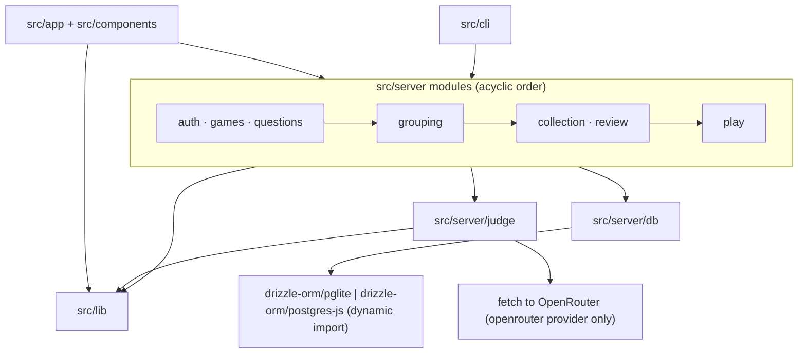
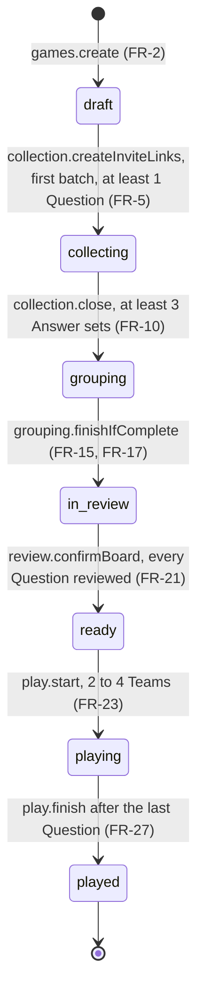
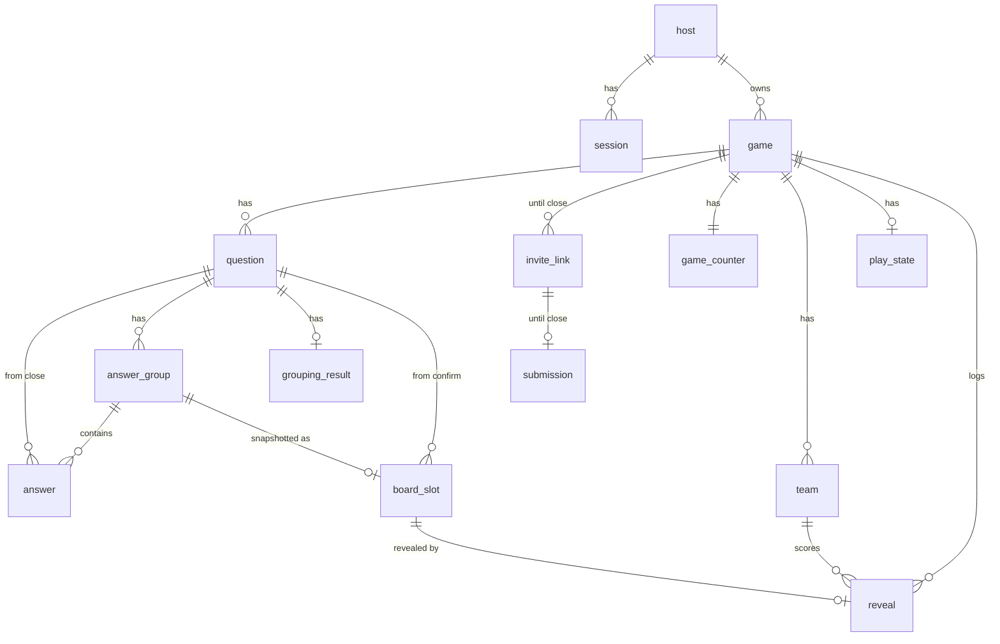
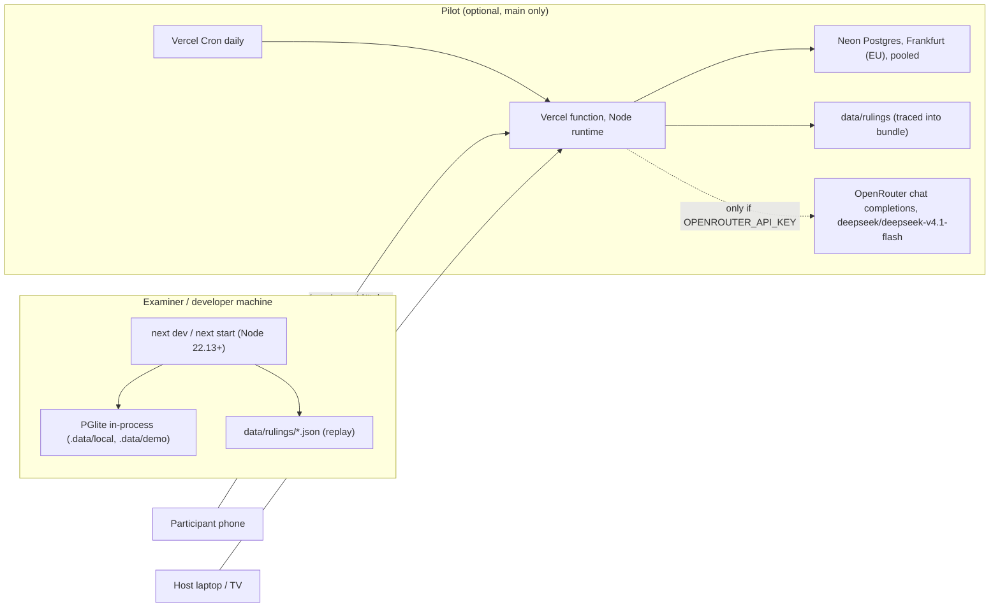

# Architecture Spine — Toppsvar

## Design Paradigm

**Modular monolith, layered.** One Next.js App Router app sits at the repo root. Each domain module under `src/server/` owns its tables and rules. Routes and UI only call the functions a module exports. UX behaviour and visuals come from `EXPERIENCE.md` and `DESIGN.md`. This spine fixes the contracts beneath them.

| Layer | Directory | Holds | May import |
| --- | --- | --- | --- |
| Routes and UI | `src/app/`, `src/components/` | pages (server components read data), client components, `actions.ts` Server Actions as thin adapters | module entry points (server code only), `src/lib` |
| Domain modules | `src/server/<module>/` | entry points, services, transactions; every file starts with `import 'server-only'` | `src/server/db`, `src/server/judge`, modules earlier in the order, `src/lib` |
| Data access | `src/server/db/` | Drizzle schema, client factory, migrator, `Tx` type | `src/lib` |
| Pure logic | `src/lib/` | normalisation, ranking, game-state table, zod schemas, errors, B-cubed, shuffle, token, limits; no I/O | nothing above |
| CLI | `src/cli/` | demo, Judge evaluation, ruling recording | module entry points, `src/lib` |



## Invariants & Rules

### AD-1 — One app, layered modules, one owner per table, `tx` passed down [ADOPTED]

- **Binds:** all
- **Prevents:** a separate backend service; UI code that queries tables; two modules writing one table; nested transactions that deadlock PGlite.
- **Rule:** The app is one Next.js App Router + TypeScript + Tailwind CSS app. `src/app` and `src/components` never import `src/server/db` or a Judge provider. A module may call only the modules before it in the order shown in the diagram. Only the owning module writes a table, and other modules call the owner's exported writers.
  - **Entry points.** A function called by an action, a route or the CLI is an entry point. It opens the transaction and takes no `tx`.
  - **Exported writers.** A function exported for other modules takes `tx: Tx` as its first parameter. It runs only on that `tx` and never opens a transaction or touches the `db` singleton.
  - **Enforcement.** ESLint `no-restricted-imports` zones encode the layers and the module order.

| Module (`src/server/…`) | Owns | Writers exported to other modules | FRs |
| --- | --- | --- | --- |
| `auth` | `host`, `session` | `requireHost` (read) | FR-1 |
| `games` | `game`, `game_counter`; retention purge | `lockForMutation`, `transition`, `reserveInviteLinks`, `acquireGroupingLease`, `bumpCounters`, `find` (read, no owner check, for `/svar`) | FR-2, FR-3, FR-18 |
| `questions` | `question` | `setReviewed`, `count` (read), `ofGame` (read) | FR-4 |
| `grouping` | `answer`, `answer_group`, `grouping_result` | `insertAnswers`, `moveAnswers`, `mergeGroups`, `setCustomLabel`, `setDiscarded`, `clearContributorData`. *Amended in Story 5.3:* no `createGroup` or `deleteIfEmpty`; `moveAnswers` creates the `host` Group and deletes emptied sources | FR-13, FR-15 to FR-17, FR-20 |
| `collection` | `invite_link`, `submission`; close | — | FR-5 to FR-11 |
| `review` | `board_slot` | `getBoard` (read) | FR-19 to FR-21 |
| `play` | `team`, `play_state`, `reveal` | — | FR-23 to FR-27 |
| `judge` | no tables; reads `data/rulings/*.json` | `getJudge` | FR-15, FR-32 |

### AD-2 — Embedded Postgres locally, ordinary Postgres deployed, chosen by `DATABASE_URL` [ADOPTED]

- **Binds:** NFR-1, NFR-2, NFR-3, all modules
- **Prevents:** code that branches on environment; a Docker or hosted DB on the examiner path; two processes corrupting one PGlite directory; first-run failure on a fresh clone.
- **Rule:** `src/server/db/client.ts` is the only place that picks a driver. It parses `DATABASE_URL` with its own parser.
  - **Schemes.** `pglite://<relative-or-absolute-dir>` gives in-process PGlite on disk, and `pglite://:memory:` gives in-memory PGlite. `postgres://` or `postgresql://` gives postgres.js with `prepare: false`, so it works behind a pooler. Unset means `pglite://.data/local`.
  - **Driver loading.** Drivers are imported dynamically, so the deployed bundle never loads PGlite's WASM.
  - **Queries.** Every query is written once, against Drizzle's Postgres API.
  - **PGlite rules:**
    - `client.ts` creates the directory recursively before opening it.
    - One process opens a directory at a time.
    - The client is a singleton cached on `globalThis`.
    - `@electric-sql/pglite` is listed in `serverExternalPackages`.
    - Every DB-reading route calls `await connection()`, so `next build` never touches the DB.
  - **Fallback.** If in-process PGlite fails under Next in the first story, run `pglite-server --run` (pglite-socket) and use postgres.js everywhere. Only `client.ts` changes.

### AD-3 — Drizzle schema and committed SQL migrations

- **Binds:** all modules, CI, Demo mode, environments (AD-24)
- **Prevents:** schema drift between PGlite and Postgres; hand-edited or pushed schemas; migrations that clash between epic branches.
- **Rule:** The schema lives only in `src/server/db/schema.ts`. `npm run db:generate` (drizzle-kit) writes SQL to `drizzle/`, which is committed and never edited after merge.
  - **Applying migrations.** The Drizzle migrator for the active driver applies them through `npm run db:migrate`. `dev`, `demo` and the test setups migrate automatically, but only for `pglite://` URLs.
  - **Parallel branches.** Before merging, a branch deletes its unmerged migrations, rebases onto `main` and regenerates. CI runs `drizzle-kit check`.
  - **Postgres features.** Only core Postgres is allowed (`gen_random_uuid()`, `jsonb`, a unique index on `lower(email)`), with no extensions.

### AD-4 — Game state machine with one lock-and-check path

- **Binds:** FR-2 to FR-27, §4.1
- **Prevents:** two features moving a Game through different paths; operations that run in the wrong state; races between close, revoke, submit and Grouping.
- **Rule:** `game.state` ∈ `draft | collecting | grouping | in_review | ready | playing | played`.
  - **Locking.** Every state-dependent mutation, Participant submits included, starts with `games.lockForMutation(tx, { hostId?, gameId, states })`. It does `SELECT … FOR UPDATE`, applies AD-5 when `hostId` is given, throws `WRONG_STATE` or `NOT_FOUND`, and touches `game.updated_at` only for Host calls. No other code locks `game`.
  - **Transitions.** State changes go only through `games.transition(tx, gameId, from, to)`, a compare-and-set. Only the transitions in the diagram exist. Stage 2 adds `games.createFromQuestionSet`, which inserts a Game directly in `ready` (FR-33).
  - **Permitted operations.** The table below lives in `src/lib/game-state.ts`, and an integration test walks the whole matrix.
  - **Deletion** locks the row and is allowed in any state.



| State | Permitted operations |
| --- | --- |
| `draft` | add, edit, reorder and remove Questions; create Invite links (refused with zero Questions) |
| `collecting` | create Invite links; revoke and replace one; open a link; submit or replace an Answer set; close |
| `grouping` | Grouping writes only |
| `in_review` | merge, move to an existing or new Group, rename, discard, undo discard, mark and unmark reviewed, confirm |
| `ready` | start play |
| `playing` | scored or unscored reveal, undo, next Team, next Question, finish |
| `played` | none |

### AD-5 — Authorisation: the owned Game first, then every child ID inside it

- **Binds:** FR-1, FR-2, FR-12
- **Prevents:** answering "not yours" and "does not exist" differently; one Host's request writing or reading another Host's Questions, Answers, Groups, slots or Teams.
- **Rule:**
  - **Session.** Host entry points take `hostId` from `auth.requireHost()`, which each Host page and action calls. No proxy makes an auth decision.
  - **The Game.** The Game is resolved through `lockForMutation` for mutations, or `games.getOwned` for reads. Both throw `NOT_FOUND` whether the Game is missing or belongs to someone else.
  - **Child IDs.** Every other input ID (`questionId`, `groupId`, `answerId`, `boardSlotId`, `teamId`) and every pasted link is resolved by a query constrained to the owned `gameId`. The IDs in one Review operation must also share one `question_id`. Any miss is `NOT_FOUND`, and the whole operation is refused.
  - **Rendering.** Pages turn `NOT_FOUND` into the bokmål 404. Under `/svar` the segment has its own `not-found.tsx`, which renders the Participant's "unknown link" page instead, with no Host chrome. A Game page behind `loading.tsx` streams, so its `NOT_FOUND` renders the bokmål not-found UI with status 200 and `noindex`, identical for missing and foreign Games; logged-out redirects happen in the spill layout before streaming.

### AD-6 — In-app auth: scrypt, hashed DB sessions, bounded cost [ADOPTED]

- **Binds:** FR-1, NFR-8
- **Prevents:** native-module installs; a third-party auth provider; session tokens that can be read from the DB; memory exhaustion or online guessing through login.
- **Rule:**
  - **Passwords** are 10 to 256 characters. They are hashed with `node:crypto` scrypt, `N=2^17, r=8, p=1`, with a 16-byte salt and `maxmem` raised to fit, and the parameters are stored in the hash string.
  - **Hashing limits.** At most 2 scrypt runs at a time per process. An unknown email is checked against a fixed dummy hash.
  - **Lockout.** `host.failed_logins` and `locked_until` double the lockout after 5 failures. Every failure gives one generic message.
  - **Sessions.** A session is a 32-byte random token in an `httpOnly`, `SameSite=Lax` cookie. The cookie is `Secure` when `APP_BASE_URL` is https, and its `Max-Age` is 14 days. The DB stores only `sha256(token)`. `session.expires_at` is authoritative, and `auth.getSession` extends it at most once an hour.
  - **Registration** requires `REGISTRATION_CODE` when that variable is set.
  - **`/svar`.** No auth code runs under `/svar`.

### AD-7 — Invite links: Token in the fragment, generic shell, Token-gated reads

- **Binds:** FR-5, FR-6, FR-7, FR-9, FR-10, FR-11, FR-14
- **Prevents:** Tokens in server, host or proxy logs or in `Referer`; Questions leaking to link previews; resolving a Token against the wrong Game; Host identity on the answer page.
- **Rule:** The link is `<APP_BASE_URL>/svar/<gameId>#<token>`.
  - **Token.** 32 bytes from `crypto.randomBytes`, base64url-encoded (`src/lib/token.ts`). Only `sha256(token)` is stored, in `invite_link.token_hash`, which is the primary key and unique across Games.
  - **Shell.** The server render of `/svar/[gameId]` is generic: `<title>Toppsvar</title>`, `noindex`, no Open Graph tags, no Game title and no Questions. It shows only the status: `unknown` (no such Game), `closed` (state is not `collecting`) or `open`. It sends `Referrer-Policy: no-referrer`, reads no session cookie and renders no Host chrome.
  - **Reads and writes.** The client reads the fragment. Questions and any saved Answer set come only from the Server Action `openInviteLink(gameId, token, editSecret?)`. Submits go through `submitAnswerSet`. No token ever appears in a GET URL or a query string.
  - **Lookup order.** The Game in the URL first: no Game means `LINK_UNKNOWN`, a state other than `collecting` means `COLLECTION_CLOSED` (close deletes every link, so closed must win over unknown). Then find `invite_link` by `(token_hash, game_id)` with no lock; no row means `LINK_UNKNOWN`. `openInviteLink` is a read and stops there. `submitAnswerSet` then does `lockForMutation` on the Game and re-checks the row and `collecting` under the lock, otherwise `COLLECTION_CLOSED`.
  - **Logging.** No code logs a token, hash, edit secret, Answer or `/svar` action argument (AD-17).

### AD-8 — Before close: one opaque Answer set per link, readable only on the submitting device

- **Binds:** FR-5 to FR-9, FR-12
- **Prevents:** half-finished Answer sets on the server; the Host reading Answers or per-link state before close, through Host pages or by opening a link they hold; more than one Answer set per link.
- **Rule:**
  - **Storage.** `submission` has its primary key = foreign key `invite_link.token_hash`, with ON DELETE CASCADE. It stores `answers jsonb` and `edit_secret_hash`. The shape is `{ [questionId]: string[] }`: every Question present, 1 to 5 trimmed non-empty strings of at most 80 characters each, in field order, so `rank = index + 1`. The schema is in `src/lib/answer-set.ts` and is checked again inside `collection.submit` against the stored Question IDs.
  - **Edit secret.** On the first submit, the browser generates a 32-byte edit secret in the Token's shape (43 base64url characters) and keeps it in `localStorage` under the single key `toppsvar:<gameId>:<first 16 chars of token>`. The key's value is JSON `{ token, editSecret, draft }` with the full Token; `draft` is the raw field values per Question, written about 500 ms after typing stops and on submit, and dropped after a successful submit. It never reaches the server before a submit. One device reuses its secret across submits. No hashing happens in the browser, because `crypto.subtle` is undefined on plain `http://<LAN-IP>`. The whole key is cleared when the server answers `closed` or `unknown`, but only when its stored Token equals the current Token exactly, so a cut-short link that shares the key never clears the real link's secret. Submits go through the Server Action `submitAnswerSet`, whose module entry point is `collection.submit`. `openInviteLink(gameId, token, editSecret)` returns `answers` only on a hash match, and otherwise the same response as an unused link. Without it, the form is empty, exactly like an unused link, and a submit replaces the set and its secret. This narrows FR-7 to the submitting device (see Deferred).
  - **Revoke** is refused with `LINK_CAP_REACHED` before anything changes if `game.invite_links_issued` is already 50. Otherwise it deletes the link by `(token_hash, game_id)`, which cascades to its submission, and returns one new link. A pasted link that matches no active link of the Game returns the inline `LINK_UNKNOWN`, not `NOT_FOUND`. The response is the same whether or not a set existed. Every link creation goes through `games.reserveInviteLinks`. The entry point is `collection.revokeInviteLink(hostId, { gameId, link })`: the owner lock comes first (`NOT_FOUND`, `WRONG_STATE`), then the cap, then the link. The inline `LINK_UNKNOWN` carries the Host copy in `fieldErrors.link`, so the Participant's `LINK_UNKNOWN` message is unchanged.
  - **Host reads.** `collection.progress(hostId, gameId)`, owner-checked through `games.getOwned` (`NOT_FOUND` for missing, foreign and malformed IDs, AD-5), returns `{ active, issued, submissions }`: the active-link count, `issued` (`game.invite_links_issued`, for "N av maks 50 lenker brukt") and the submission count, with `submissions` the literal `"fewer-than-3"` below three and never the exact number. The Game page reads `issued` only from it. No Host-visible value, timestamps included, changes when a Participant submits.

### AD-9 — Closing Collection is the single anonymisation step

- **Binds:** FR-10, FR-13, SM-3
- **Prevents:** Answers that keep a link to a Token, an Answer set or arrival order after close; a close that leaves Token hashes behind or is only partly done.
- **Rule:** `collection.close` runs one transaction:
  1. `lockForMutation(collecting)` and require at least 3 submissions.
  2. For each submission and each Question, draw a new `crypto.randomUUID()` Contributor key and build that Question's Answer rows.
  3. Shuffle every Answer row of the whole Game with a crypto Fisher-Yates shuffle (`src/lib/shuffle.ts`), then call `grouping.insertAnswers(tx, rows)` once.
  4. Delete the Game's `submission` and `invite_link` rows.
  5. `transition(collecting → grouping)`. This also sets `grouping_lease_until = now() + 180 s`.

  After commit, a best-effort `VACUUM (FULL, SKIP_LOCKED) submission, invite_link` runs outside any transaction. Its errors are swallowed and logged by SQLSTATE only, and it never fails the close. The same best-effort VACUUM runs after deleting a Game that was `collecting`, so the helper (`vacuumCollectionTables`) lives in the db layer (`src/server/db/vacuum.ts`), since `games` may not import `collection`. *Amended in Story 3.1:* `SKIP_LOCKED` replaces `lock_timeout = '2s'`. VACUUM cannot run in a transaction block, so `SET lock_timeout` would need a second statement on the same connection, which a pooled postgres.js client does not guarantee without driver-specific code (AD-2). With `SKIP_LOCKED`, in one statement, the VACUUM never waits for a lock and never queues an ACCESS EXCLUSIVE request ahead of live submits; it skips a table someone holds. The rewrite itself still holds ACCESS EXCLUSIVE on each table briefly while it runs. *Amended in the Epic 3 review:* a skipped table is retried and reported. The hourly purge (`purgeExpired`) runs the same helper on every run, not only after deleting a `collecting` Game, so a table that `SKIP_LOCKED` skipped at close is rewritten within about an hour. Postgres reports a skip (a held table, or a role that does not own it) only as a notice, so the helper compares each table's `relfilenode` before and after: `VACUUM FULL` always writes a new file, and an unchanged one logs `{ module, op: "vacuum", code: "VACUUM_SKIPPED" }` and nothing else. It must stay `FULL`: a plain VACUUM leaves the dead tuples' bytes in the table file. Then the action starts Grouping with `after()` (AD-12). Nothing else inserts into `answer`.

### AD-10 — Answers carry no order and no identity, and Host views never see the linking columns

- **Binds:** FR-11, FR-12, FR-13, SM-3
- **Prevents:** IDs, timestamps or physical order that show arrival; Answers joined across Questions; Review showing which Answers share a contributor or rank.
- **Rule:** `answer` has exactly these columns:
  - `id` (uuid v4, `gen_random_uuid()`)
  - `question_id`
  - `contributor_key` (uuid v4, random for each Question and Answer set, nullable)
  - `rank` (1 to 5, nullable)
  - `text`
  - `normalized_text`
  - `group_id` (nullable until Grouping)

  Banned on `answer` and `answer_group`: `serial`/`identity`, `uuidv7`, ULIDs, `created_at`/`updated_at` and any column that grows with each insert. No table stores a Participant's name, email, IP, user agent or device ID.

  Host-facing queries and DTOs never select `contributor_key` or `rank`. Review gets each Group's `count` and `rank1_count` as SQL aggregates, and Answers sorted by `normalized_text`, then `text`. When `review.confirmBoard` commits, `grouping.clearContributorData` sets `contributor_key` and `rank` to NULL for the Game.

  `tests/integration/anonymity.test.ts` checks the schema and data after close and after confirm. It also checks that no key appears under two Questions, and that no Token, hash or submission remains.

### AD-11 — Count, Score and ranking: SQL aggregates, one ranking module

- **Binds:** FR-15, FR-16, FR-20, FR-21, FR-25, FR-26
- **Prevents:** stored totals drifting from the data; Review and confirm ranking Groups differently; labels outside 1 to 40 characters.
- **Rule:**
  - **Count** is computed only in SQL, as `count(distinct contributor_key)` per Group. **Score** is the SQL sum of `board_slot.count` over a Team's scored reveals. Neither is stored, except that `board_slot.count` freezes at confirm (AD-15).
  - **Ranking module.** Order and the Board cut are decided only by `rankGroups()` and `boardCut()` in `src/lib/ranking.ts`, over rows of `{ groupId, count, rank1Count, labelCandidates }`. The ranking is Count, then rank-1 Answers, then the label under `Intl.Collator('nb', { sensitivity: 'base' })`, then `groupId`. Review display, the "not on the Board" split and `confirmBoard` all call these.
  - **Default label.** The `normalized_text` given by the most distinct Contributor keys, ties broken by the shortest. It is cut to 40 characters at a word boundary.
  - **Effective label.** `custom_label ?? defaultLabel`.
  - **Merge** keeps the ID of the highest-ranked source Group and freezes its effective label as `custom_label`.

### AD-12 — Grouping: one partition call per Question, run once, resumable without duplicates

- **Binds:** FR-15, FR-16, FR-17, FR-18, §6.2
- **Prevents:** re-running Grouping or running it twice at once; one slow Question blocking the rest; all-pairs cost; a Game stuck in `grouping`; a missing key treated as an error.
- **Rule:**
  - **Normalisation.** `src/lib/normalize.ts`, `NORMALIZE_VERSION`: Unicode NFC, locale-independent `toLowerCase()`, trim, collapse inner whitespace, strip trailing `.,!?;:…`. If nothing is left, use the trimmed lower-cased text.
  - **Items.** A Question's items are its distinct normalised texts, sorted by code-unit order.
  - **Judge call.** There is one `judge.partition` call per Question, under a 30 s `AbortSignal`. At most 5 Questions run at once. The Judge is never called inside a transaction.
  - **Fallback.** A `JudgeError` (or any other throw, which counts as `ERROR`) gives the Question one Group per item, with `fell_back = true` and `fallback_reason` ∈ `NO_KEY | NO_STORED_RULING | TIMEOUT | ERROR | REFUSAL | INVALID_OUTPUT`. Review presents `NO_KEY` and `NO_STORED_RULING` as the normal group-by-hand state. It lists the other reasons as Judge failures (FR-17).
  - **Writing results.** In one transaction per Question: `lockForMutation(grouping)`; insert the Groups (`origin` is `judge`, or `fallback` for fallback Groups and Groups made only of uncovered replay items); set `answer.group_id`; insert `grouping_result` (unique per `question_id`); call `bumpCounters`. A Question that already has a result is skipped. *Amended in Story 5.3:* Review's "Ny gruppe" inserts its Group with `origin = host` (a third `group_origin` value) and a `randomUUID()` id, through `grouping.moveAnswers`; it is never `judge` or `fallback`.
  - **Running and resuming.**
    - The close action calls `after(() => grouping.run(gameId))`, which runs once. Module functions never call `after()`.
    - A Host page load in `grouping` calls `grouping.resumeIfStale(gameId)`. That function takes the lease with `acquireGroupingLease` (compare-and-set on `grouping_lease_until < now()`) and runs only if it won the lease. The runner extends the lease after each Question.
    - Both paths end in `finishIfComplete`, which locks, counts results and moves the Game to `in_review`.
    - If the Game has been deleted, the run stops quietly.
  - **Progress.** `grouping.progress(gameId)` returns Questions done out of the total, for the UX Grouping panel.
  - **Cost.** Without retries, for the sizing Game: 15 calls, about USD 0.004, at most 90 s. For the largest Game: 20 calls, about USD 0.008, at most 120 s. The arithmetic is in `delivery-notes.md`. Identical normalised Answers are one item, so none is judged twice. At most two requests per Question (one retry), so at most 40 per Game (PRD FR-15).
- *Amended in Story 4.2:*
  - **Timer.** The runner owns the 30 s bound: it aborts its own `AbortController` after `JUDGE_TIMEOUT_MS` and races the call against that abort, so a provider that ignores the signal still falls back with `TIMEOUT`. Any other throw is `ERROR`.
  - **Result columns.** `source` is `judge` for a `live` result, `replay` for a `stored` one and `fallback` on fallback. `prompt_version` and `model_id` come from `judge.info`. On fallback `judge_calls` and `uncovered_items` are 0, since `JudgeError` carries no call count (a `shortcut:` in `grouping` until the live provider of Story 4.4 can fail after spending calls).
  - **Lease.** `games.acquireGroupingLease(gameId)` (one compare-and-set `UPDATE`) and `games.extendGroupingLease(tx, gameId)` live in `games`, which owns `game`, and share the database-time expression `transition` uses at close. A lock that finds the Game gone (`NOT_FOUND`) or past `grouping` (`WRONG_STATE`) ends the whole run without a throw or a log line.
  - **Page.** The Game page in `grouping` reads `grouping.progress`, polls every `GROUPING_POLL_MS` (3 s), and calls `resumeIfStale` inside `after()` only when the lease has expired, so a page load never waits for Grouping. The close action and the page both `.catch(() => {})` the task, since the boundary has already logged it.
  - **Reads.** `grouping.summary(gameId)` gives the *in review* summary (Questions, Groups with `origin = judge`, fallen-back Questions), and `grouping.countsOf(questionId)` gives each Group's `count(distinct contributor_key)`.
  - **Foreign key.** `answer.group_id` references `answer_group` with `ON DELETE CASCADE`, like every other key under `game`.
  - **Deferred.** `edit_count` is not added here: Review (Epic 5) increments it, and Story 4.3 adds the column with the report that reads it. `bumpCounters` also arrives with 4.3. *Resolved in Story 4.3* (see AD-18).
- *Amended in Story 4.4:*
  - **Result columns.** `prompt_version` and `model_id` come from the result (`PartitionResult.model`, `.promptVersion`): mock and live report their `info`, replay the ruling that covers the first covered item. On fallback they come from `judge.info`.
  - **Calls on fallback.** `JudgeError` carries `calls`, so a fallen-back Question records the requests its provider sent (`judge_calls`) and bumps the `judgeCalls` counter by the same figure; any other throw counts 0. The Story 4.2 `shortcut:` is gone.
  - **Timer.** The runner's timeout rejects one `setImmediate` after its abort, so a provider that honours the signal settles first with `TIMEOUT` and its call count; a provider that ignores the signal still falls back with `TIMEOUT` and 0 calls.

### AD-13 — One Judge boundary, three providers

- **Binds:** FR-15, FR-17, FR-28 (Stage 2), FR-30, FR-32, §6.4, NFR-3
- **Prevents:** callers tied to one vendor; network calls in tests or Demo mode; a second Judge for Guess matching; retry counts that make SM-C2 wrong.
- **Rule:** `src/server/judge/index.ts` exports `getJudge()`, `JudgeError` (with a `reason: FallbackReason`) and this interface:

```ts
interface Judge {
  readonly info: { provider: 'openrouter' | 'replay' | 'mock'; model: string; promptVersion: string };
  partition(
    input: { question: string; items: string[] },
    signal: AbortSignal,
  ): Promise<{ assignments: number[]; calls: number; uncovered: number; source: 'live' | 'stored' }>;
}
```

Stage 2 adds `match({ question, guess, labels }, signal)` to the same interface. No stub or comment for it ships in Stage 1.

- **Selection.** `JUDGE_PROVIDER` picks the provider. Unset means `openrouter` when `OPENROUTER_API_KEY` is set, otherwise `replay`.
- **Valid output.** `assignments.length === items.length`, every value an integer cluster number. Providers validate and canonicalise the output (numbering in first-occurrence order `0..k-1`). Invalid output throws `INVALID_OUTPUT`.
- **replay** finds rulings in `data/rulings/*.json` by `normalize(question)`. It applies the stored clusters to the items those rulings cover, and numbers each uncovered item as its own cluster after them. If nothing is covered, that is a miss. A miss throws `NO_KEY` when no key is configured, otherwise `NO_STORED_RULING`.
- **openrouter** uses a stored ruling only when its item set matches exactly (`source: 'stored'`). Otherwise it POSTs with the built-in `fetch` (no SDK) to `https://openrouter.ai/api/v1/chat/completions` with these settings:
  - model `JUDGE_MODEL` (default `deepseek/deepseek-v4.1-flash`, a pinned ID, never a `~…-latest` alias, so Stored rulings name the model that made them)
  - `response_format: { type: "json_schema", json_schema: { strict: true, schema } }` for `{ assignments: number[] }`, `temperature: 0`, a bounded `max_tokens` and reasoning off (`reasoning: { effort: "none" }`), since reasoning tokens count against `max_tokens`
  - `provider: { require_parameters: true, data_collection: "deny" }`, so the request is routed only to providers that honour the schema and do not store or train on the Answers
  - one retry on invalid output, 429 or 5xx, inside the signal
  - an aborted signal throws `TIMEOUT`, and `finish_reason: "content_filter"` throws `REFUSAL`

  Only the Question text and the items are sent.
- **mock** is deterministic. It uses a map the test supplies, or one cluster per item. It is used only by Vitest.
- **Prompt.** The prompt and `PROMPT_VERSION` live only in `src/server/judge/prompt.ts`, with no real-person text. Any change to the prompt bumps the version.
- **Quality bar.** SM-2 is B-cubed F1 of at least 0.70 on `judge:eval`. Until the Stage 1 freeze (1 December), a shortfall may be addressed by changing the prompt (bumping `PROMPT_VERSION`), the effort or `JUDGE_MODEL` (any OpenRouter model with `structured_outputs` whose `reasoning.mandatory` is not `true`, since such a model rejects `effort: "none"` with a 400, which is `ERROR` on every Question) and re-recording; each version tried is listed in the README. After the freeze the figure is final and reported unchanged (PRD SM-2 decision rule).
- **Imports.** Nothing outside `src/server/judge` imports a provider or calls the model endpoint.
- *Amended in Story 4.1:*
  - `JudgeError`, `FallbackReason`, the `Judge` type and `canonicalise` live in `src/server/judge/core.ts`, which `index.ts` re-exports, so providers share them without an import cycle through `index.ts`.
  - **Numbering.** `canonicalise` runs on raw output: stored assignments, mock maps and the model's reply. replay then numbers covered clusters `0..c-1` in first-occurrence order over the covered items, and uncovered items `c..k-1` in item order, so Grouping finds the uncovered singletons as the last `uncovered` cluster numbers. With several rulings for one Question, each item takes its cluster from the first matching ruling (files in name order) that covers it, and cluster identity is (ruling, stored cluster), so two rulings never merge clusters. Only rulings whose `normalizeVersion` equals `NORMALIZE_VERSION` match.
  - **replay** loads every `*.json` once per instance. A missing `data/rulings` means no rulings, so every call is a miss. A malformed file (bad JSON, not an array, a record that breaks the AD-14 shape, non-normalised items, or an extra key) throws a plain `Error` naming the file, not a `JudgeError`, so Grouping counts it as `ERROR`.
  - **info.** Static per provider: replay is `{ provider: 'replay', model: 'replay' }` and mock `{ provider: 'mock', model: 'mock' }`, both with `PROMPT_VERSION`. Each stored ruling keeps its own model and prompt version in its file.
  - **mock** takes its map keyed by the exact Question text (`createMockJudge(map)`) and reports `calls: 1`, `source: 'live'`.
  - **Imports.** "Or the SDK" becomes a ban on the endpoint: an ESLint rule rejects any string or template literal containing `openrouter.ai`, in any letter case, in `src/` outside `src/server/judge`. It catches literals only, not a host built from pieces at runtime.
  - Until Story 4.4, `JUDGE_PROVIDER=openrouter` (the key-derived default) selects replay.
- *Amended in Story 4.2:* **mock** failure injection. A map value may also be a `FallbackReason`, thrown as `JudgeError(reason)`, or an `Error`, thrown as is. `"TIMEOUT"` first waits for the signal to abort, as the live provider will, so every fallback reason is testable offline.
- *Amended in Story 4.4:*
  - **Interface.** `JudgeError(reason, calls = 0, status?)`, where `status` is the last non-2xx HTTP status (read only by `judge:smoke`), and `partition` also returns `model` and `promptVersion`, since replay mixes rulings from different models and prompt versions that a static `info` cannot name.
  - **openrouter** is `src/server/judge/providers/openrouter.ts`. The request body is `{ model, messages, response_format: { type: "json_schema", json_schema: { name: "partition", strict: true, schema } }, temperature: 0, max_tokens: MAX_TOKENS, reasoning: { effort: "none" }, provider: { require_parameters: true, data_collection: "deny" } }` with only the `Authorization` and `Content-Type` headers. Retry once on invalid output, 429 or ≥ 500; other non-2xx and network errors are `ERROR`. `calls` counts every request sent, on success and on failure. No exact stored ruling and no key is `NO_KEY`. `info` is `{ provider: "openrouter", model: JUDGE_MODEL, promptVersion: PROMPT_VERSION }`, and `JUDGE_PROVIDER=openrouter` (including the key-derived default) now selects it.
  - **Prompt.** `prompt.ts` holds the system prompt, `messages(input)`, `ASSIGNMENTS_SCHEMA` and `MAX_TOKENS` (2,048: the largest Question's 250 items at up to 4 tokens each, twice over). `reasoning` and `max_tokens` are request settings, so changing them does not bump `PROMPT_VERSION`. The user message is `JSON.stringify({ question, answers: items })`. This first prompt is version `"1"`.
  - **CLI access.** `index.ts` exports `getLiveJudge(onUsage?)` (openrouter without stored rulings) and the recorder helpers from `record.ts`, so `src/cli` never imports a provider.

### AD-14 — Stored ruling format

- **Binds:** FR-15, FR-31, FR-32
- **Prevents:** rulings that can't be replayed or compared; rulings that reveal arrival order; Demo and evaluation fixtures in different formats.
- **Rule:**
  - **Shape.** A ruling is `{ kind: "partition", promptVersion, normalizeVersion, model, question, items, assignments }`, where `items` are sorted distinct normalised texts.
  - **Fixtures.** Fixture files are JSON arrays: `data/rulings/demo.json` and `data/rulings/protoqa-dev.json`. They are written only by `npm run judge:record`, which needs a live key.
  - **In the DB.** A Game's stored ruling is its materialised Groups plus `grouping_result(question_id, source: judge | replay | fallback, prompt_version, normalize_version, model_id, judge_calls, uncovered_items, fell_back, fallback_reason)`.
- *Amended in Story 4.4:* `npm run judge:record <input.json> <output.json>` reads a JSON array of `{ question, answers }`, makes one partition per entry (up to two requests with the retry) over its sorted distinct non-empty normalised answers, and writes the rulings with the result's `model` and `promptVersion`. It refuses before any call without `OPENROUTER_API_KEY` or for an output path outside `.data/` other than the two fixtures, and a `JudgeError` writes nothing. `npm run judge:smoke` makes one live call on a fixed synthetic Question and prints model, latency, calls, usage and the groups; without a key it prints `skipped: no OPENROUTER_API_KEY` and exits 0. Neither is part of the test scripts or CI.
- *Amended in Story 7.1:* `data/rulings/demo.json` is hand-written, since there was no live key when the demo was built. It has the recorder's exact shape, with `model` and `promptVersion` both `"hand-written"` so nothing claims a model made it. `npm run judge:record -- <input.json> data/rulings/demo.json` (input: `[{ question, answers }]` from `src/server/demo.ts`), then `npx prettier --write data/rulings/demo.json`, may replace it; `demo-replay.test.ts` then checks the recorded partition still covers every item.

### AD-15 — Review closes with a Board snapshot, and play reads only the snapshot

- **Binds:** FR-19 to FR-21, FR-23 to FR-27, FR-33 (Stage 2)
- **Prevents:** play reading Review data that is still changing; a Question reaching play with no Groups; a separate play path for Question-set Games.
- **Rule:**
  - **Review writes.** Review edits Groups only through `grouping`'s writers (AD-1). Every edit increments the affected Groups' `edit_count`, bumps counters and calls `questions.setReviewed(tx, id, false)`. That is the only `question` write allowed outside `draft`. *Amended in Story 5.4:* discard and restore only flip `answer_group.discarded` through `grouping.setDiscarded`; no Group or Answer is deleted. A discarded Group is frozen: it is never a merge, move or rename source or target (`NOT_FOUND`), and must be restored first. `boardCut` keeps it off the Board and out of the ninth-Group promotion, so `confirmBoard` never puts it in play.
  - **Marking reviewed** is refused with `NO_GROUPS_ON_BOARD` while a Question has no non-discarded Group.
  - **`review.confirmBoard`** requires every Question to be reviewed. It writes `board_slot(id, question_id, position 1..8, label, count, group_id nullable)` from `boardCut(rankGroups(...))`, calls `grouping.clearContributorData`, and moves the Game to `ready`. *Amended in Story 5.5:* a Question left unreviewed is refused with the new code `QUESTIONS_UNREVIEWED` ("Gjennomgå alle spørsmålene først."), since neither `WRONG_STATE` nor `NOT_FOUND` describes a Board that another tab un-reviewed. A Question whose Board would be empty is refused with `NO_GROUPS_ON_BOARD`, as marking is. The Counts are read before `clearContributorData`, because they are computed from the Contributor keys it clears. `review.setReviewed` marks and unmarks (AD-4) with no counter or `edit_count` change; the UI only marks.
  - **Play** reads only `board_slot`, through `review.getBoard`.

### AD-16 — Play state is saved as a reveal log

- **Binds:** FR-3, FR-23 to FR-27, NFR-5
- **Prevents:** play state held only in the browser; Scores out of step with reveals; reveals credited to the wrong Team or Question; ambiguous "next Question".
- **Rule:**
  - **Question order.** `question.position` is dense `1..n` and unique per Game. It is renumbered in the same transaction on every remove or reorder, and frozen after `draft`.
  - **Tables.**
    - `team(id, game_id, name 1..14, position)`
    - `play_state(game_id, current_question_id, current_team_id)`
    - `reveal(id, game_id, board_slot_id unique, team_id nullable, seq)`, where a null `team_id` means an unscored reveal
  - **Reveal** takes only `{ boardSlotId, scored }`. The Team comes from `play_state` under the Game lock. A slot that is not on the current Question is refused with `WRONG_QUESTION`, and a slot that is already revealed with `ALREADY_REVEALED`.
  - **Undo** deletes the highest-`seq` reveal on the current Question.
  - **Next Question** is the one with the smallest greater position. When there is none, `finish` moves the Game to `played`, sets `played_at` and returns `deleteAfter = played_at + 30 days`.
  - **Reload.** The play view renders from this saved state on the server.

### AD-17 — Mutations, reads and the error boundary

- **Binds:** all FRs that mutate, FR-11
- **Prevents:** a mix of REST endpoints and actions; unvalidated input; error shapes that differ between features; driver errors carrying Tokens or Answers into logs or the dev overlay.
- **Rule:**
  - **Reads.** Pages read data in server components. After a mutation, the action calls `revalidatePath`. There is no client data library.
  - **Mutations and token reads** are Server Actions in `src/app/**/actions.ts`, with their zod shape schemas in a sibling `schema.ts`. A module entry point enforces every invariant again, using the shared schemas from `src/lib`, so the CLI and tests get the same checks.
  - **Result shape.** Actions return `{ ok: true, data } | { ok: false, code, message, fieldErrors? }`. The only exception is `redirect()` flows (login, create Game, delete Game).
  - **Error codes.** `ErrorCode` is a closed union, with bokmål messages, in `src/lib/errors.ts`. A zod failure gives `INVALID_INPUT` with `fieldErrors`.
  - **Error boundary.** Entry points and `after()` tasks convert any error that is not a `DomainError` into `DomainError('INTERNAL')`, with no cause and no original message. `src/server/log.ts` receives only `{ module, op, code, sqlstate }`. Actions never throw to Next.
  - **Route Handlers** are limited to `GET /api/health` (no side effects), `GET /api/purge` (requires `CRON_SECRET`, AD-23) and `GET /api/spill/[gameId]/rapport` (the AD-18 export).
  - **Polling.** Host pages poll with `router.refresh()` every 3 s while the Game is `grouping`, and every 30 s while it is `collecting` (ProgressCount). There are no websockets.

### AD-18 — Usage counters are content-free and written through one function

- **Binds:** FR-18, SM-5, SM-C1
- **Prevents:** counters holding Answer text; modules bumping counters in different ways; SM-5 being impossible to compute.
- **Rule:**
  - **`game_counter`** (one row per Game): `judge_groups_proposed`, `groups_merged`, `answers_moved`, `groups_created`, `groups_renamed`, `groups_discarded`, `groups_restored`, `judge_calls`, `questions_fell_back`.
  - **Writers.** Only `games.bumpCounters(tx, gameId, delta)` changes these counters, called by `grouping` and `review`.
  - **Export.** `rapport` returns these counters, each Question's `source` and `fell_back`, and the `origin` and `edit_count` of every Group.
  - **SM-5** is the share of `origin = judge` Groups that reach the Board with `edit_count = 0`, plus the median `edit_count` of the changed ones.
- *Amended in Story 4.3:*
  - **Lazy row.** `game_counter` is keyed by `game_id` (`ON DELETE CASCADE`) and has only the nine integer counters, each `not null default 0`. `bumpCounters` is one upsert that inserts the row with the delta or adds the delta to it, so `games.create` makes no row and `games.counters(gameId)` returns zeros for a Game that never bumped.
  - **Grouping's bump.** In the Question's transaction, after the already-done skip: `judgeGroupsProposed` is that Question's `origin = judge` Groups, `judgeCalls` the stored `judge_calls`, which since Story 4.4 counts every request sent, also on fallback (`JudgeError.calls`), `questionsFellBack` 1 or 0. A failed bump rolls back the Question's Groups, `group_id`s and result. Host-made Groups (Story 5.3) must not use `origin = judge`, or they would count as proposed. *Resolved in Story 5.3:* they use `origin = host`.
  - **`edit_count`.** `answer_group.edit_count integer not null default 0`; Review increments it. *Amended in Story 5.3:* `answers_moved` counts Answers, a "Ny gruppe" move to a new Group included (which also bumps `groups_created` by 1); a move adds `edit_count + 1` to the target and to every surviving source, so the new `host` Group ends at 1.
  - **States.** `REPORT_STATES` (`in_review`, `ready`, `playing`, `played`) in `src/lib/game-state.ts`, outside `PERMITTED`, which is the mutation table.
  - **Route.** `GET /api/spill/[gameId]/rapport` composes `auth.requireHost`, `games.getOwned`, the state check, `games.counters` and `grouping.usage` like the Game page does, since `grouping` imports `games`. Body: `{ counters: { judgeGroupsProposed, groupsMerged, answersMoved, groupsCreated, groupsRenamed, groupsDiscarded, groupsRestored, judgeCalls, questionsFellBack }, questions: [{ position, source, fellBack, groups: [{ origin, editCount }] }] }`, Questions by `position`, Groups by id, as an attachment `toppsvar-bruksrapport.json` with `Cache-Control: no-store`. Failures are `{ code, message }`: `NOT_FOUND` 404 (missing, foreign and malformed alike), `WRONG_STATE` 409, anything else 500 `INTERNAL`; logged out redirects to `/logg-inn`. The Game page links to it as a `button-secondary`-styled `<a>` without `download`.
  - **SM-5's "reach the Board" is not in the report yet.** No `board_slot` exists in 4.3, so the report cannot tell a Group on the Board from a discarded or cut one. The story that writes `board_slot` (5.5, `confirmBoard`) adds an on-Board flag per Group to the report, from `board_slot.group_id`, so a discarded or cut `origin = judge` Group with `edit_count = 0` is not read as accepted.
- *Amended in Story 5.5:* each Group in `questions[].groups` is now `{ origin, editCount, onBoard }`. `onBoard` is true when a `board_slot` row has the Group's `group_id` (a read-only left join), so it is false for every Group before the lock and for cut or discarded ones after it. Nothing else is added to the report.

### AD-19 — Demo mode: invented fixtures, replay, one cross-platform command

- **Binds:** FR-30, FR-31, NFR-1, UJ-5, §6.1
- **Prevents:** a demo that needs a key or network; real people's data in the repository; a demo that differs from the real flow; shell syntax that fails on Windows.
- **Rule:** `npm run demo` runs `src/cli/demo.ts` through `tsx`, with no shell syntax:
  1. Recreate `.data/demo`.
  2. Migrate.
  3. Seed through module functions: an invented demo Host, whose credentials are one constant in `src/lib` (printed and listed in the README, and read by the login page and the Demo band when `DEMO_MODE=1`), and one demo Game in `collecting` with invented Norwegian Questions and Answer sets.
  4. Start `next dev` on `PORT` with `DATABASE_URL=pglite://.data/demo`, `JUDGE_PROVIDER=replay`, `DEMO_MODE=1` and a matching `APP_BASE_URL`.

  The rulings for the demo Answers are in `data/rulings/demo.json`, so close takes the normal Grouping path. Answers added before close become their own Groups. No tracked file holds text derived from `.idea/`, including fixtures, few-shot examples, tests, rulings and `prompting/`.
- *Amended in Story 7.1:*
  - **Seeding.** `auth.register` sets a cookie, so it needs a request. `auth.createHost(input)` validates with `registrationSchema`, hashes and inserts the Host with no session or cookie. The demo Game, its three Questions, six Answer sets and the seed itself live in `src/server/demo.ts` (`seed()`, and `seedAndClose()` for the CLI, which releases the PGlite directory before `next dev` opens it), shared by the CLI and `demo-replay.test.ts`. Eight links are issued and six answered.
  - **Command.** `npm run demo` adds `--tsconfig tsconfig.cli.json` to the AD-21 CLI form. Under `react-server` React has no `createContext`, so plain Node cannot load `next/navigation`'s client build, which `src/server/boundary.ts` and `auth` import; `tsconfig.cli.json` maps it to Next's `navigation.react-server` build, as Next's own bundler does for server code. `next dev` is spawned as `process.execPath` plus Next's bin with `--port` from the parsed `PORT`, with SIGINT and SIGTERM forwarded. Only the fixed path `.data/demo` is deleted.
  - **Surfaces.** `/` (now rendered per request) and `/logg-inn` show the login in an info Notice when `DEMO_MODE=1`, passed from the server page, never imported by a client component; the login page adds "Fyll inn demobrukeren". `HostChrome` takes `demo` from the spill layout and the root 404 page and shows the band inside the `<header>` landmark, below the bar, so it hides with the header (`data-host-chrome`) under the play stage.

### AD-20 — Judge evaluation command and ProtoQA data

- **Binds:** FR-32, SM-2, SM-4, SM-C2, §6.1, §6.3
- **Prevents:** evaluation that needs the network by default; scraped ProtoQA data or real Answers in the repository; a missing CC-BY-4.0 credit.
- **Rule:** `npm run judge:eval` runs `src/cli/judge-eval.ts`.
  - **Input.** It reads `data/protoqa/dev.crowdsourced.jsonl`: the crowdsourced dev questions with hand-made clusters, from `iesl/protoqa-data`, CC-BY-4.0. The file has 52 rows; the dataset README says 51.
  - **Default and live.** By default it replays `data/rulings/protoqa-dev.json` and warns when the ruling's versions differ from the current ones. `--live` regenerates the rulings and needs a key.
  - **Scoring.** Raw answers are normalised. Each item's weight is the sum of its respondents, and its gold cluster is the cluster holding most of that weight.
  - **Output.** B-cubed precision, recall and F1 (`src/lib/bcubed.ts`), Judge calls per Question, the prompt version and the model ID.
  - **Local data.** `--file <path>` scores a local labelled set (SM-4) and prints aggregates only. `judge:record -- <input.json> <output.json>` (AD-14, amended in Story 4.4) writes only under `.data/`, except for the two fixtures `data/rulings/demo.json` and `data/rulings/protoqa-dev.json`.
  - **Licensing.** `data/protoqa/ATTRIBUTION.md` gives the credit and license, states the changes made, and covers `protoqa-dev.json`. Scraped and train files are never committed.

### AD-21 — Configuration through environment variables only

- **Binds:** NFR-1, NFR-2, NFR-8
- **Prevents:** builds that differ in code between environments; committed secrets; README and code disagreeing about variables.
- **Rule:**
  - **Reading.** The app reads only the variables below, through `src/server/env.ts` (zod-validated).
  - **Template.** `.env.example` lists every variable with a safe default or an empty value. A test checks that its keys equal those in `env.ts`.
  - **Git.** `.env*` files (except `.env.example`), `.data/`, `.next/` and `node_modules/` are gitignored.
  - **CLI.** `src/cli` runs as `tsx --conditions=react-server --env-file-if-exists=.env.local`. *Amended in Story 4.4:* the `judge:*` scripts also read `.env` first (`--env-file-if-exists=.env --env-file-if-exists=.env.local`), and `no-console` is off in `src/cli`.

| Variable | Default | Purpose |
| --- | --- | --- |
| `DATABASE_URL` | `pglite://.data/local` | DB driver and location (AD-2) |
| `PORT` | `3000` | local dev and demo port |
| `APP_BASE_URL` | `http://localhost:${PORT}` | origin for Invite links; https enables `Secure` cookies |
| `OPENROUTER_API_KEY` | empty | turns on the live Judge; optional |
| `JUDGE_PROVIDER` | derived (AD-13) | `openrouter`, `replay` or `mock` |
| `JUDGE_MODEL` | `deepseek/deepseek-v4.1-flash` | OpenRouter model ID for the live provider |
| `DEMO_MODE` | empty | `1` shows the demo login hint and band, from the `src/lib` demo credentials constant (AD-19) |
| `REGISTRATION_CODE` | empty | if set, registration requires it. *Amended 2026-11-23:* not set on the pilot, whose registration is open (AD-24) |
| `CRON_SECRET` | empty | if set, enables `/api/purge` (pilot) |

### AD-22 — Test layout, guards and CI [ADOPTED]

- **Binds:** NFR-3, SM-1, SM-3, FR-11, FR-12, FR-13, FR-30, §9.1
- **Prevents:** tests that pass only online or on the live Judge path; shared test DBs; CI checking something other than what the README runs; FR consequences without a test.
- **Rule:**
  - **`tests/unit/`** tests `src/lib`: Score over reveals, ranking and labels over aggregates, normalisation, Token generation, shuffle, B-cubed and the game-state table.
  - **`tests/integration/`** runs module entry points against a fresh `pglite://:memory:` DB per file, with the real migrations. Required files:
    - `anonymity.test.ts`
    - `host-view.test.ts`
    - `collection.test.ts`: reopen and extend on the same device, an empty form without the secret, one set per link, revoke, foreign tokens, refusal after close, submit racing close, and server output free of Tokens and Answers on a forced DB error
    - `review.test.ts`: recount on merge and move
    - `authz.test.ts`: a foreign child ID for every Host action
    - `game-state.test.ts`
    - `demo-replay.test.ts`: `source = replay`, `uncovered_items = 0`, no fallback
    - `judge-eval.test.ts`: the replayed run is offline and prints precision, recall, F1, calls per Question, prompt version and model; the figures equal the pinned values for the committed rulings (re-pinned whenever they are re-recorded before the freeze); it reports whether 0.70 is met and never fails on a figure below it
    - `env.test.ts`
  - **`tests/e2e/`** runs Playwright against `next build && next start`, with a fresh temporary PGlite directory and `JUDGE_PROVIDER=replay`. A second server, `next dev` on its own port (3101) and PGlite directory, serves only `server-output.spec.ts`, since only development mode prints Server Function arguments and forwards browser console output. Both servers' stdout and stderr are redirected to files, and the global teardown fails the run if either file is missing or empty, or holds a Token, edit secret or Answer that a browser sent or received, or its sha256 (recorded in the shared `localOnly` helper). Each spec registers its own Host, and only `demo.spec.ts` uses the demo Game. Required specs:
    - `no-key.spec.ts` (FR-30)
    - `host-anonymity.spec.ts`: every Host page and response during Collection, before and after a Participant submits; reopening a used link from a fresh browser context shows an empty form
    - `participant.spec.ts`
    - an `@axe-core/playwright` pass over the answer form, Review and play
    - capture of the server's output, which fails on any Token or Answer text
  - **`tests/manual/`** holds `checklist.md` (FR-24 legibility, the rest of NFR-6, NFR-5 timing) and `anonymity-audit.md`, the SM-3 procedure for a dump after confirm.
  - **`tests/TRACE.md`** maps every Stage 1 FR consequence to a test or a manual item. Test titles carry FR IDs, and a unit test checks that every Stage 1 FR appears.
  - **Guards.** Vitest sets `JUDGE_PROVIDER=mock`, clears `OPENROUTER_API_KEY` and rejects requests to any host but localhost. Playwright sets `replay` and blocks requests to any host but localhost in the browser. The Next server is guarded by having no key.
  - **CI.** `.github/workflows/ci.yml` runs on `pull_request` and on push to `main`, on Node 22 and 26, with no key and `NEXT_TELEMETRY_DISABLED=1`. It runs only README scripts:
    - `npm ci`
    - lint, format check, typecheck
    - `drizzle-kit check`
    - `npm test`
    - Playwright install, then `npm run test:e2e`
    - a demo smoke test: start `npm run demo` in the background, poll `/api/health`, then stop it
  - **CI Postgres job.** A second job runs `tests/integration` against a Postgres service container.
  - **`server-only`** is aliased to an empty module in Vitest.
  - *Amended in Story 7.1:* the 3101 server is `npm run demo` (same port, same `dev.log` capture) instead of `npm run dev`, since Next 16 locks the dist dir per `next dev` and `demo.spec.ts` needs the demo Game. `server-output.spec.ts` keeps its guarantee there, since the demo is `next dev`, and still registers its own Host. An e2e run recreates the working copy's `.data/demo`. The CI demo smoke runs last, after the e2e run, for the same lock, and fails with the log after 120 s.

### AD-23 — Retention purge

- **Binds:** FR-3, §6.1
- **Prevents:** orphan rows after deletion; retention that depends only on someone visiting the app.
- **Rule:**
  - **Cascade.** Every child table references `game` with `ON DELETE CASCADE`.
  - **What is purged.** `games.purgeExpired()` deletes Games 30 days after `played_at`, and Games never played 90 days after `updated_at`. `updated_at` reflects Host activity (AD-4).
  - **When it runs.** At most once an hour per process (the marker is in memory on `globalThis`, and the delete is idempotent). It is triggered from Host requests and from `GET /api/purge`. On the pilot, a daily Vercel Cron calls `/api/purge` with `CRON_SECRET`.
  - **Failure.** A purge failure is caught and never fails the request that triggered it.
  - **Timestamps.** Game-level timestamps (`created_at`, `updated_at`, `played_at`, `grouping_lease_until`) are allowed. Answer-level timestamps are not (AD-10).

### AD-24 — Environments and deployment

- **Binds:** NFR-1, NFR-2, NFR-5, FR-15
- **Prevents:** a preview or dev run migrating shared data; code that works only on serverless or only on a long-running server; the examiner path depending on a host.
- **Rule:** The app runs on the Node.js runtime only (no Edge). `next.config.ts` sets:
  - `serverExternalPackages: ['@electric-sql/pglite']`
  - `outputFileTracingIncludes` for `data/rulings/**`
  - `agentRules: false`

  The Game page exports `maxDuration = 300`. *Amended in Story 3.1:* a `"use server"` file may export only async functions, so the close action cannot export it; it inherits the setting from the Game page it posts to.

| Environment | `DATABASE_URL` | Migrations | Live Judge |
| --- | --- | --- | --- |
| Local dev (`npm run dev`) | `pglite://.data/local` | automatic (PGlite only) | if a key is in `.env.local` |
| Demo (`npm run demo`) | `pglite://.data/demo`, recreated | automatic | never (`replay`) |
| Test and CI | `pglite://:memory:`, temp directory, Postgres service | automatic in setup | never |
| Pilot (production) | Neon Postgres, Frankfurt (EU), pooled URL | explicit `npm run db:migrate` deploy step | yes, through a key with a USD 0.10 credit limit |
| Pilot previews | `pglite:///tmp/toppsvar`, per function instance | automatic (PGlite only) | never (no key) |

The pilot is Vercel Hobby (300 s per function with fluid compute), with production from `main` only. *Amended 2026-11-23 (group decision):*

- **Open registration.** `REGISTRATION_CODE` is not set, so anyone with the address can create a Host account. `CRON_SECRET` stays set for the daily purge (AD-23).
- **Previews on.** Preview deployments set `DATABASE_URL=pglite:///tmp/toppsvar` and no `OPENROUTER_API_KEY`. They never reach the production database or the Judge, and their data lasts only as long as the function instance.
- **Production.** Neon Postgres in Frankfurt (EU) and an OpenRouter key with a USD 0.10 credit limit, which is the cost cap. When the credit is used up, OpenRouter refuses the request, the Judge reports `ERROR`, and the Question starts with one Group per distinct normalised Answer (FR-17).

There are no backups beyond Neon's short history, and the pilot database is deleted when the course ends. Any Node host running `next start` with a Postgres URL is equivalent. The README's local path never mentions a host.

## Consistency Conventions

| Concern | Convention |
| --- | --- |
| Language | Code, file names, DB names and comments in English. User-facing text and URL segments in bokmål ASCII. `<html lang="nb">`, with bokmål `not-found.tsx`, `error.tsx` and `global-error.tsx`. No i18n library (NFR-7). |
| Routes | As in `EXPERIENCE.md`: `/`, `/registrer`, `/logg-inn`, `/spill`, `/spill/[id]`, `/spill/[id]/gjennomgang`, `/spill/[id]/skjerm`, plus `/svar/[gameId]` (AD-7) and the AD-17 API routes. |
| Domain names | PRD glossary terms used as written: `game`, `question`, `inviteLink`, `answerSet`, `answer`, `contributorKey`, `group` (table `answer_group`), `boardSlot`, `team`, `reveal`, `score`, `count`. |
| DB naming | `snake_case`, singular. Primary key `id uuid default gen_random_uuid()`. Exceptions: `invite_link`, `session` and `submission` (keyed by `token_hash`); `game_counter` and `play_state` (keyed by `game_id`). Foreign keys are `<entity>_id`, `ON DELETE CASCADE` toward `game`. |
| Files | Components are `PascalCase.tsx`, everything else `kebab-case.ts`. Each module is one folder, with `index.ts` as its public surface. |
| Limits | Only in `src/lib/limits.ts`, with the values from PRD §11 plus: minimum 3 Answer sets, retention 30/90 days, Judge 30 s and concurrency 5, grouping lease 180 s, poll 3 s, collecting refresh 30 s, Team name 14, password at most 256. |
| Time and IDs | UTC `timestamptz`, only on `host`, `session` and `game`. IDs are random UUID v4, never time-ordered. |
| Logging | Only through `src/server/log.ts` (ESLint `no-console` elsewhere). It accepts `{ module, op, code, sqlstate }`, never request objects, arguments or `error.message`. |
| Transactions | A multi-row change is one transaction, opened by the entry point. The Judge is never called inside one. |
| Assets | Fonts come from npm packages or `next/font/local`, never `next/font/google` or a CDN, so builds and tests work offline. Nothing names or imitates the TV show (PRD §6.3). |
| Scripts | `dev`, `demo`, `build`, `start`, `lint`, `format`, `format:check`, `typecheck`, `test`, `test:e2e`, `db:generate`, `db:migrate`, `judge:eval`, `judge:record`, `judge:smoke`. README, CI and Playwright use these names only. |
| Style | ESLint flat config (`eslint-config-next`, `typescript-eslint`, `eslint-config-prettier`) and Prettier defaults, over `src`, `tests` and the root config files. Ignored: `_bmad .claude wiki .docs prompting scripts drizzle .idea .next .data .logs`. No commented-out code. |
| Delivery | The README states the anonymity limits that AD-7 to AD-10, AD-13 and AD-24 name, and the outcome of the PRD §6.5 slip list. One PR per epic. A departure from this spine amends it in the same PR. Details are in `delivery-notes.md`. |

## Stack

Do not keep the Next starter's `@types/node ^20` (vitest 5 rejects it), its `next/font/google` layout or its `lang="en"`. ESLint stays on 9 until the `eslint-config-next` plugins support 10.

| Name | Version |
| --- | --- |
| Node.js (prerequisite; CI matrix) | ≥ 22.13, tested on 22 and 26 LTS |
| Next.js (App Router) | 16.4.6 |
| React / React DOM | 19.3.1 |
| TypeScript | 6.0.3 |
| `@types/node` / `@types/react` / `@types/react-dom` | 22.20.5 / 19.3.0 / 19.3.0 |
| Tailwind CSS + `@tailwindcss/postcss` | 4.3.5 |
| `@electric-sql/pglite` (local, test) | 0.5.17 |
| `postgres` (postgres.js, deployed) | 4.1.1 |
| `drizzle-orm` / `drizzle-kit` | 0.45.4 / 0.31.11 |
| `zod` | 4.6.7 |
| Judge model | `deepseek/deepseek-v4.1-flash` via OpenRouter (USD 0.05 / 0.20 per million input / output tokens, `structured_outputs` supported; checked 2026-11-22) |
| `vitest` | 5.1.1 |
| `@playwright/test` / `@axe-core/playwright` | 1.65.1 / 4.14.0 |
| `eslint` / `eslint-config-next` / `typescript-eslint` | 9.39.5 / 16.4.6 / 8.73.0 |
| `prettier` / `eslint-config-prettier` | 3.10.1 / 10.1.8 |
| `tsx` / `server-only` | 4.23.15 / 0.0.1 |
| `@fontsource-variable/bricolage-grotesque` (self-hosted display font) | 5.3.0 |
| Pilot hosting | Vercel Hobby (Node runtime) + Neon Postgres, Frankfurt (EU) |

## Structural Seed





```text
./                          # repo root = app root; docs and BMAD sit beside the code, excluded from lint
  src/
    app/                    # routes per EXPERIENCE.md, layouts, actions.ts + schema.ts per route
      svar/[gameId]/        # Participant shell + client form
      spill/ registrer/ logg-inn/
      api/                  # health, purge, spill/[gameId]/rapport
      fonts/                # self-hosted font files if not from npm
    components/
    server/
      env.ts  log.ts
      db/                   # schema.ts, client.ts, migrate.ts
      auth/ games/ questions/ grouping/ collection/ review/ play/
      judge/                # index.ts, core.ts, prompt.ts, providers/{openrouter,replay,mock}.ts
    lib/                    # normalize, ranking, game-state, answer-set, errors, bcubed, shuffle, token, limits
    cli/                    # demo.ts, judge-eval.ts, judge-record.ts
  drizzle/                  # generated SQL migrations (committed)
  data/
    protoqa/                # dev.crowdsourced.jsonl, ATTRIBUTION.md
    rulings/                # demo.json, protoqa-dev.json
  tests/
    unit/ integration/ e2e/ manual/  TRACE.md
  docs-assets/              # README screenshots
  .github/workflows/ci.yml  .github/pull_request_template.md
  package.json  package-lock.json  tsconfig.json  next.config.ts  postcss.config.mjs
  drizzle.config.ts  vitest.config.ts  playwright.config.ts  eslint.config.mjs
  .prettierrc  .prettierignore  .env.example  .nvmrc  .gitignore (+ .data/)
  scripts/make-zip.sh       # beside the existing doc tooling
  README.md  CLAUDE.md  proposal.md  product-brief.md  PRD.md
  wiki/ .docs/ prompting/ _bmad/ .claude/ .logs/   # existing, unchanged
```

**Examiner path (NFR-1):** with Node ≥ 22.13 and git installed, run `git clone …`, then `npm install`, then `npm run demo`.

## Capability → Architecture Map

| Capability / Area | Lives in | Governed by |
| --- | --- | --- |
| FR-1 Host account | `server/auth`, `app/registrer`, `app/logg-inn` | AD-5, AD-6 |
| FR-2, FR-3 Games, deletion, retention | `server/games` | AD-4, AD-5, AD-16, AD-23 |
| FR-4 Questions | `server/questions` | AD-4, AD-16 (positions) |
| FR-5 to FR-9 Invite links, answering, progress, revoke | `server/collection`, `app/svar` | AD-7, AD-8 |
| FR-10 Close | `server/collection` → `grouping.insertAnswers` | AD-9 |
| FR-11 to FR-13 Anonymity | `collection`, `grouping`, `review`, `log.ts`, tests | AD-7 to AD-10, AD-17, AD-22 |
| FR-14 Notice | `app/svar` | `EXPERIENCE.md`; README limits (delivery notes) |
| FR-15 to FR-17 Grouping, ranking, fallback | `server/grouping`, `server/judge`, `lib` | AD-11 to AD-14 |
| FR-18 Usage counters | `server/games`, `api/spill/[gameId]/rapport` | AD-18 |
| FR-19 to FR-21 Review, confirm | `server/review` via `grouping` writers | AD-10, AD-11, AD-15 |
| FR-23 to FR-27 Play | `server/play` | AD-15, AD-16 |
| FR-30, FR-31 No key, Demo mode | `judge` replay, `cli/demo.ts` | AD-13, AD-19 |
| FR-32 Judge evaluation | `cli/judge-eval.ts`, `data/protoqa` | AD-14, AD-20 |
| NFR-1 to NFR-3, NFR-8 | `db/client.ts`, `env.ts`, CI | AD-2, AD-3, AD-21, AD-22, AD-24 |
| NFR-4 to NFR-7 Devices, speed, accessibility, language | `app`, `components` | `DESIGN.md`, `EXPERIENCE.md`; Conventions; AD-22 axe pass |
| Stage 2: FR-22, FR-28, FR-29, FR-33 | `review`, `judge.match`, `play`, `games.createFromQuestionSet` | AD-4, AD-13, AD-15, AD-16 (doors kept open) |

## Deferred

- **Cross-device editing of an Answer set** (FR-7 narrowed by AD-8). Confirmed by the group 2026-11-21: the PRD's FR-7 is amended to the submitting device, so AD-8 binds without reservation.
- **Visual system, Review interaction, near-threshold display and unsent drafts.** These were decided in `DESIGN.md` and `EXPERIENCE.md`. Architecture constraints: no per-Group confidence signal in Stage 1, single-Answer Groups are ordinary Groups, and drafts stay in `localStorage`, under the one per-link key `toppsvar:<gameId>:<first 16 chars of token>` (no hashing in the browser), and are never sent before submit.
- **Judge prompt wording and the measured token and latency figures.** Tuned in the Judge story against `judge:eval` until the Stage 1 freeze. The format, versions and the 0.70 bar are fixed in AD-13 and AD-14.
- **Account recovery and email verification.** Not required by the PRD. Registration reveals whether an email is already taken, and that is accepted.
- **Stage 2 data.** The Question-set import format and `game.kind` (FR-33), a manual Group order column on `answer_group` (FR-22), typed Guess storage and its deletion (FR-28), and strike and steal state (FR-29). These are decided when Stage 2 starts, inside AD-4, AD-13, AD-15 and AD-16.
- **Several Hosts per Game** (PRD §1.2). The schema uses `game.host_id`, and Stage 1 adds no other single-Host assumption.
- **Observability beyond `log.ts`.** Not needed for a course pilot.
