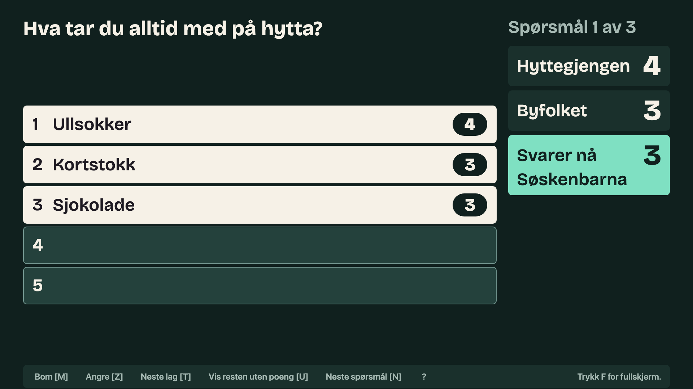
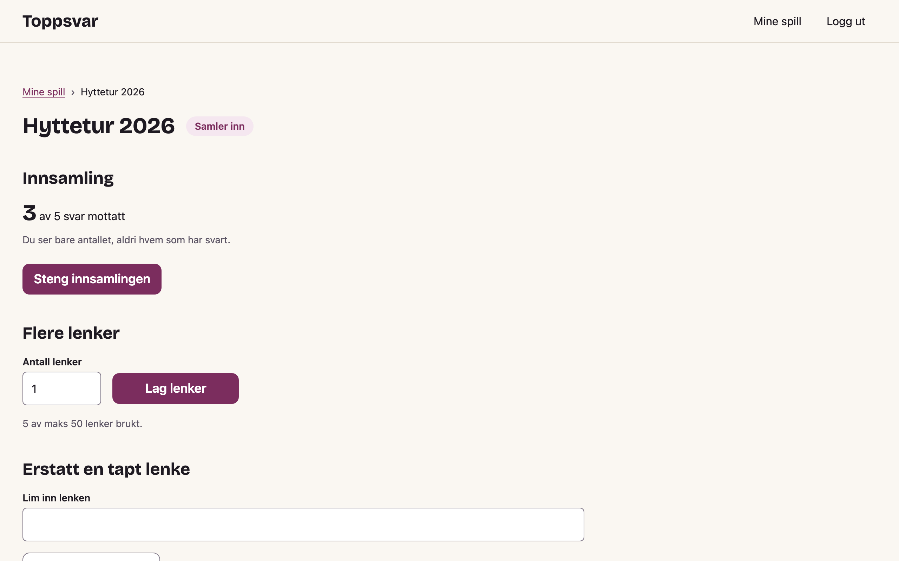
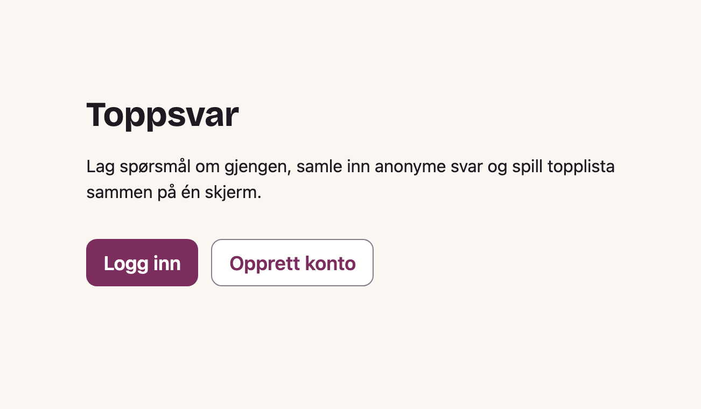
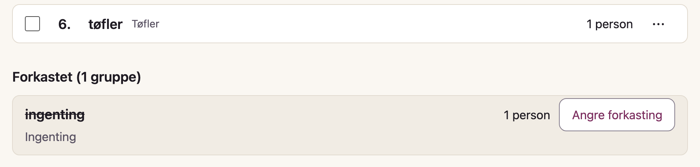
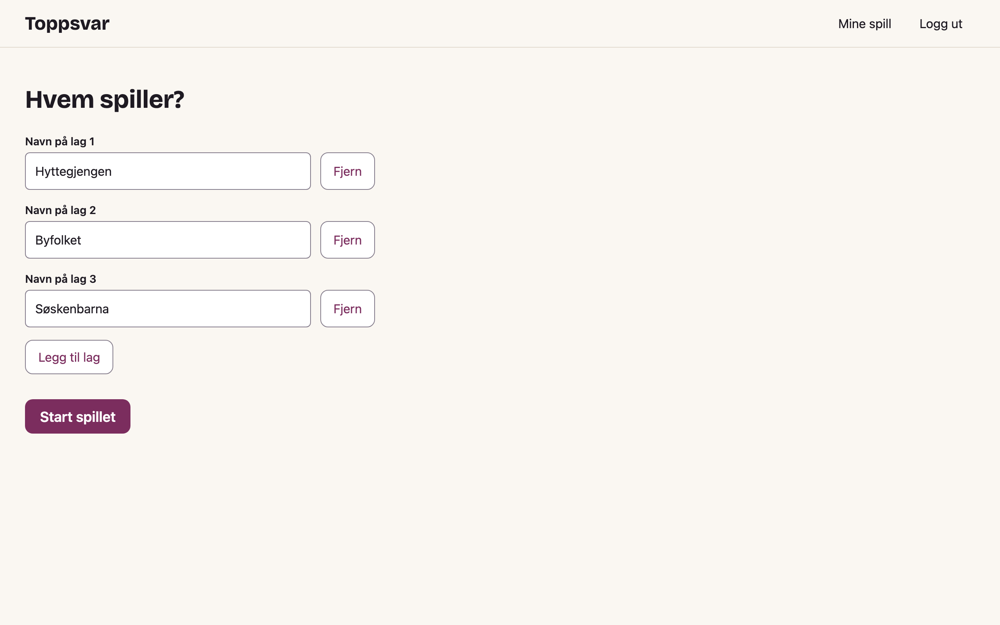
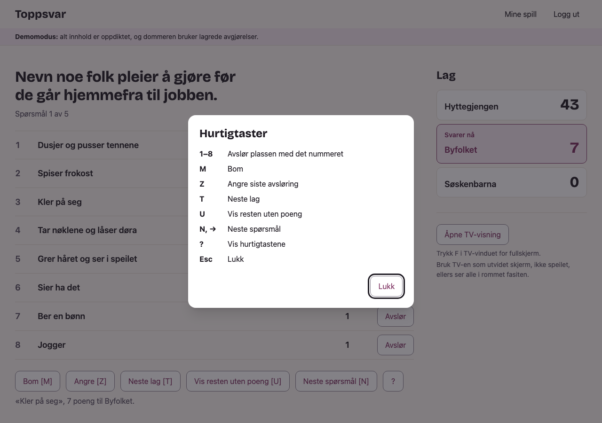
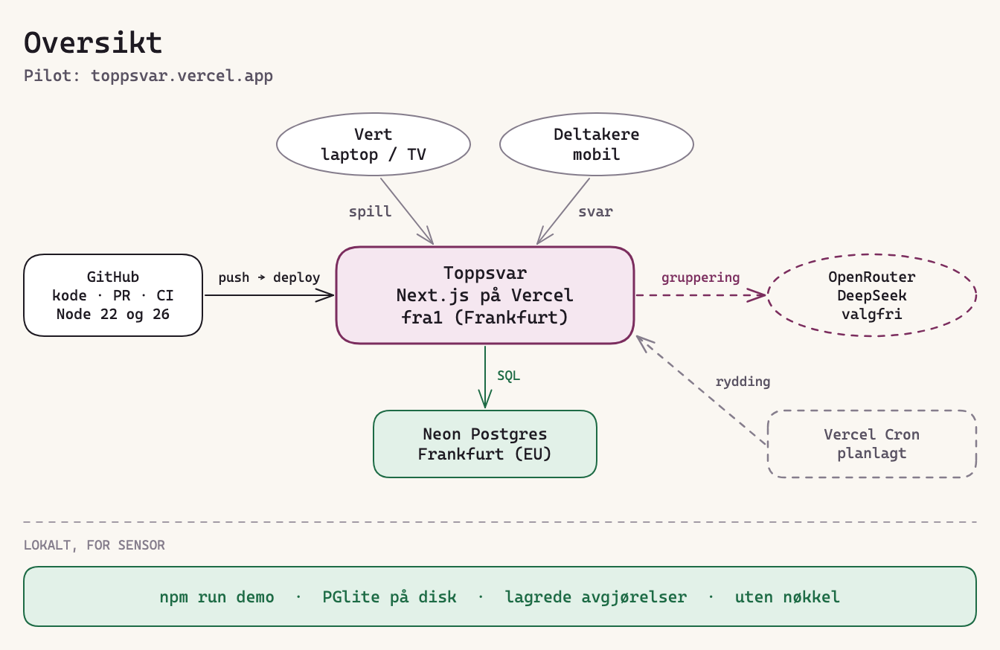
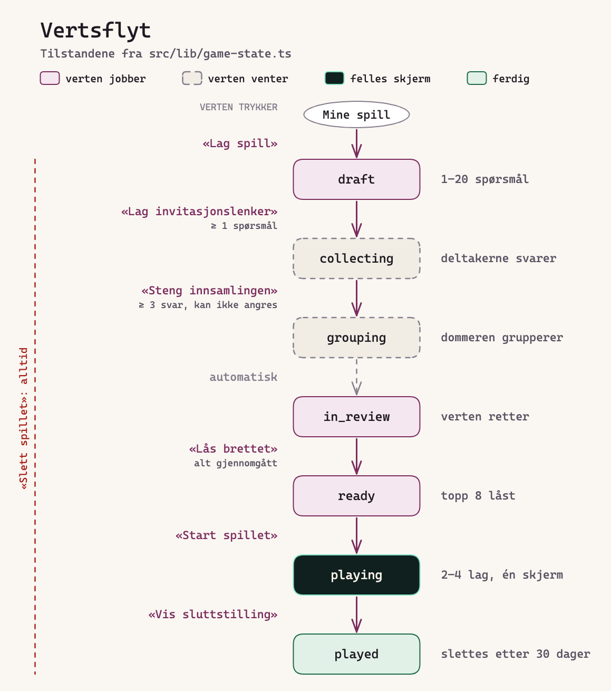

# G101 — Claudeception

Gruppeprosjekt i **IBE160 Programmering med KI** ved Høgskolen i Molde, høsten 2026 (15 studiepoeng).
Her ligger appen, og dokumentasjon av hvordan vi bygde, testet og kvalitetssikret den med KI.

## Produkt

**Toppsvar** er et Family Feud-aktig festspill. Verten lager spørsmål om sin egen gjeng, og
deltakerne svarer anonymt i fritekst. En språkmodell grupperer like svar til rangerte topplister.
Verten retter, og gjengen spiller fra én delt skjerm. Trinn 2: ferdige spørsmålssett, uten innsamling.

Pilot: <https://toppsvar.vercel.app>. Lokalt trengs verken nøkkel eller konto, se [Utvikling](#utvikling).

## Slik ser det ut

Et oppdiktet spill, «Hyttetur 2026». Gjennomgang, låst brett og spill er fra piloten, der dommeren
grupperte live. Resten er lokalt, uten nøkkel.

**Gjennomgangen.** Verten slår sammen, flytter, gir nytt navn og forkaster grupper. Her er to
valgt. Dommeren hadde alt slått sammen «Ullsokker», «ullsokker» og «ullsokkar».


**Spillet på TV-en.** Verten bruker tastaturet: tall avslører plasser, `M` bom, `Z` angre, `T`
neste lag, `U` avslør uten poeng, `N` neste spørsmål. Lagene ser bare brett og poeng.



| Deltakeren svarer på mobilen | Verten følger innsamlingen |
|---|---|
|  |  |

<details>
<summary>Flere skjermbilder</summary>

| Skjerm | Bilde |
|---|---|
| Forsiden |  |
| Spørsmålene skrives |  |
| Innsamlingen åpnes |  |
| Engangslenkene |  |
| Svaret er lagret |  |
| Innsamlingen stenges (lokalt, uten nøkkel) |  |
| Dommeren er ferdig (5 spørsmål, 30 grupper, ingen til manuell gruppering) |  |
| Gjennomgang av ett spørsmål |  |
| Forkastede grupper |  |
| Brettet er låst |  |
| Lagene navngis |  |
| Hurtigtastene |  |
| Sluttstillingen |  |

</details>

## Flytene

Laget i [Excalidraw](https://excalidraw.com). `.excalidraw`-fila ved hvert bilde kan åpnes og
redigeres der.

**Oversikt.** Piloten kjører på Vercel og Neon i Frankfurt. Lokalt trengs ingen av delene.
[Kilde](docs-assets/diagrammer/oversikt.excalidraw)



<details>
<summary><b>Vertsflyt</b>: spillets tilstander, fra utkast til sluttstilling</summary>



[Kilde](docs-assets/diagrammer/vertsflyt.excalidraw)

</details>

<details>
<summary><b>Deltakerflyt</b>: personlig lenke, anonyme svar, kan endres til innsamlingen stenges</summary>


[Kilde](docs-assets/diagrammer/deltakerflyt.excalidraw)

</details>

<details>
<summary><b>Anonymitet</b>: stengingen kutter koblingen mellom lenke og svar</summary>

Grensen: selve svarteksten kan avsløre hvem som skrev den.


[Kilde](docs-assets/diagrammer/anonymitet.excalidraw)

</details>

<details>
<summary><b>Gruppering</b>: dommeren foreslår, verten bestemmer</summary>


[Kilde](docs-assets/diagrammer/gruppering.excalidraw)

</details>

<details>
<summary><b>Arkitektur</b>: koden i src/app, src/server og src/lib</summary>


[Kilde](docs-assets/diagrammer/arkitektur.excalidraw)

</details>

## Medlemmer

- Sondre Alfnes
- Daniel P Sarjomaa

## Leveranser

| Dokument | Fase | Innhold |
|----------|------|---------|
| [`product-brief.md`](product-brief.md) | Fase 1, arbeidskrav | Hva, hvorfor og for hvem. Revidert etter tilbakemelding |
| [`proposal.md`](proposal.md) | Bakgrunn | Stack, datamodell og risiko i fjorårets format |
| [`PRD.md`](PRD.md) | Fase 2 | Krav i trinn 1 og trinn 2 |
| [`DESIGN.md`](.docs/planning-artifacts/ux-designs/ux-Toppsvar-2026-11-21/DESIGN.md) og [`EXPERIENCE.md`](.docs/planning-artifacts/ux-designs/ux-Toppsvar-2026-11-21/EXPERIENCE.md) | Fase 3 | UX, med [mockup](.docs/planning-artifacts/ux-designs/ux-Toppsvar-2026-11-21/mockups/key-screens.html) |
| [`ARCHITECTURE-SPINE.md`](.docs/planning-artifacts/architecture/architecture-Toppsvar-2026-11-21/ARCHITECTURE-SPINE.md) | Fase 3 | Arkitekturbeslutninger AD-1 til AD-24 |
| Refleksjonsrapport | Uke 48–49 | 30 % av karakteren. Leveres 5. desember |

`product-brief.md` og `PRD.md` genereres fra `.docs/planning-artifacts/` med
`./scripts/sync-brief.sh`. Rediger kildene der.

## Prosess

Vi følger **BMAD Method v6.12.0**: brief → PRD → UX og arkitektur → epics og stories →
implementering. Rammeverket ligger i `_bmad/`, skillene i `.claude/skills/`. `ponytail` er alltid
på ved koding: minste endring som løser oppgaven, uten å kutte krav, tester eller sikkerhet.
Promptene arkiveres i [`prompting/`](prompting/README.md).

## Utvikling

Krever Node.js 22.13 eller nyere (testet på 22 og 26) og git. Ingen database, nøkkel eller
konto: appen bruker innebygd PGlite i `.data/local`.

```bash
npm install
npm run dev                 # http://localhost:3000, helsesjekk på /api/health
```

Variablene står i [`.env.example`](.env.example). Kopier den til `.env.local` for å endre noe.

**Uten nøkkel** bruker dommeren lagrede kjennelser i `data/rulings/`. Mangler en kjennelse, blir
hvert ulike svar en egen gruppe (`NO_KEY`), og verten slår sammen for hånd. Så lenge mappa er tom,
er «Grupper foreslått 0» etter stenging forventet.

**Med nøkkel** (`OPENROUTER_API_KEY` i `.env` eller `.env.local`) grupperer dommeren live, opptil
minst 120 ulike svar per spørsmål. Fra 180 faller den tilbake til manuell gruppering
([målinger](.docs/planning-artifacts/architecture/architecture-Toppsvar-2026-11-21/delivery-notes.md)).

<details>
<summary>Skript som bruker nøkkelen (aldri i testene eller CI)</summary>

```bash
npm run judge:smoke         # ett live kall: modell, ventetid, tokens og grupper; hopper over uten nøkkel
npm run judge:record -- inn.json .data/rulings/ut.json   # tar opp kjennelser (AD-14); bare under .data/ eller data/rulings/demo.json og protoqa-dev.json
```

</details>

Testene trenger verken nøkkel eller nettverk. CI kjører dem på Node 22 og 26.

<details>
<summary>Kommandoene CI kjører</summary>

```bash
npm run lint                # ESLint, også lagreglene mellom src/app, src/server og src/lib
npm run format:check        # Prettier (npm run format retter)
npm run typecheck           # next typegen + tsc
npx drizzle-kit check       # migrasjonene i drizzle/ henger sammen
npm test                    # Vitest: enhets- og integrasjonstester
npx playwright install chromium   # én gang
npm run test:e2e            # Playwright mot next build && next start
```

Stopp `npm run dev` først: e2e starter sin egen `next dev`, og Next tillater bare én per repo.
Feilloggen er `dev.log` i en ny `toppsvar-e2e-*`-mappe under `$TMPDIR` (macOS) eller `/tmp` (Linux).

</details>

<details>
<summary>Database og migrasjoner</summary>

Skjemaet er `src/server/db/schema.ts`. `npm run db:generate` skriver SQL til `drizzle/`, og
`npm run db:migrate` kjører den mot `DATABASE_URL`. PGlite migreres automatisk. Stopp
`npm run dev` før `db:migrate` (én prosess per PGlite-mappe), og start dev på nytt etter
`db:generate`. Slett `.data/` for å nullstille.

</details>

## Dokumentasjon

All prosjektdokumentasjon ligger i [`wiki/`](wiki/index.md): emnekrav, tidsplan, BMAD-faser og
beslutningslogg.

```bash
./scripts/sync-brief.sh     # regenererer product-brief.md og PRD.md
./scripts/scan-cohort.sh    # ser hva andre grupper i emnet har levert
```
