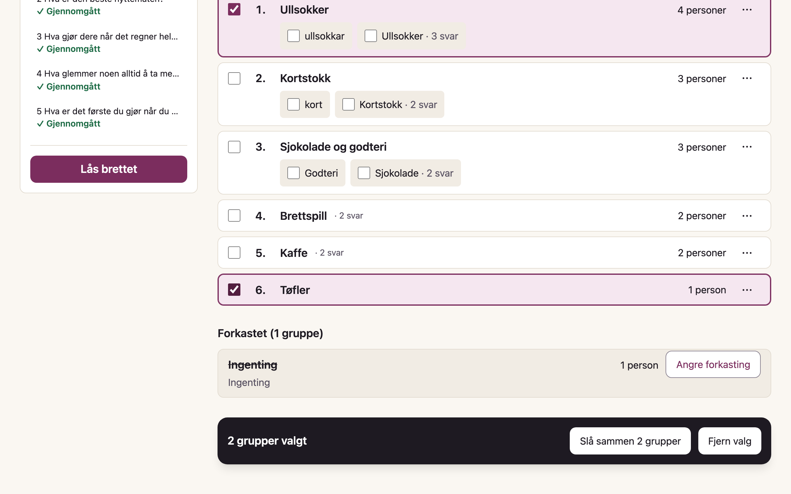
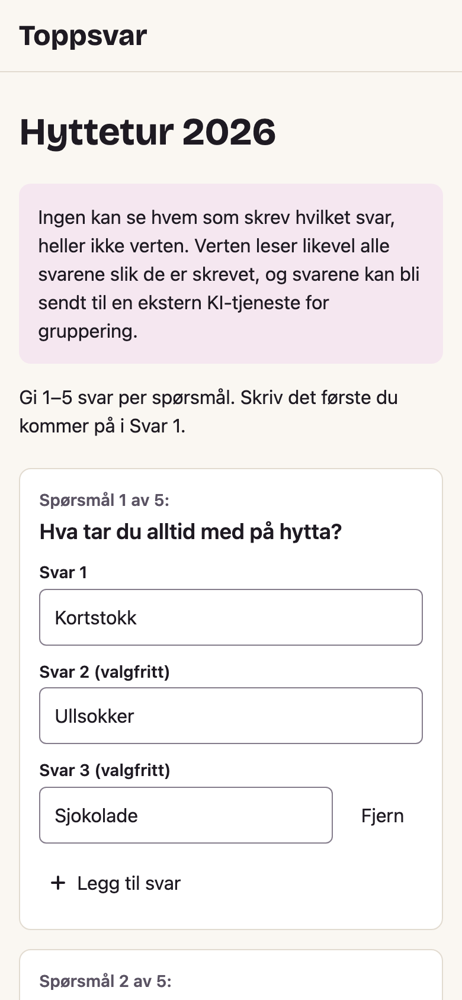
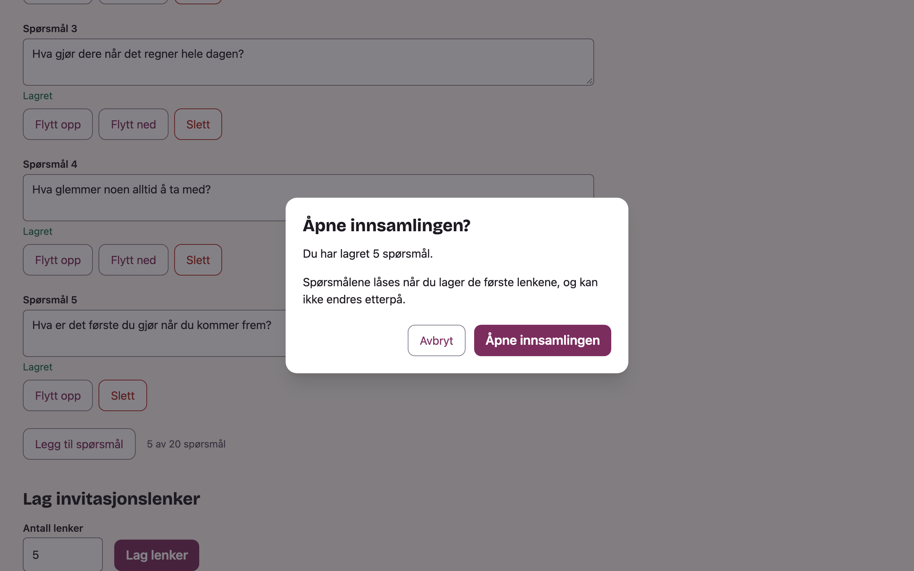
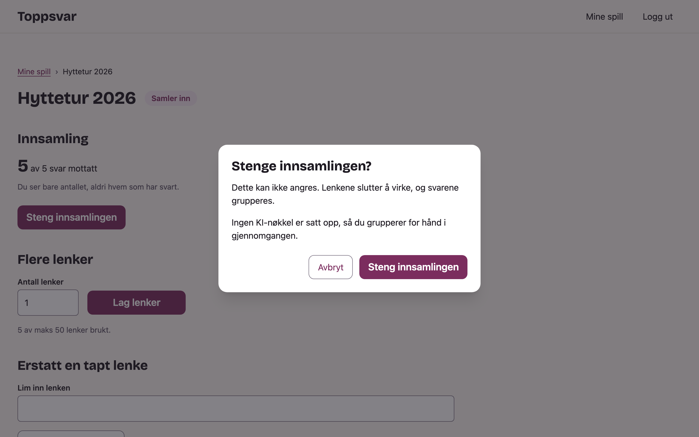
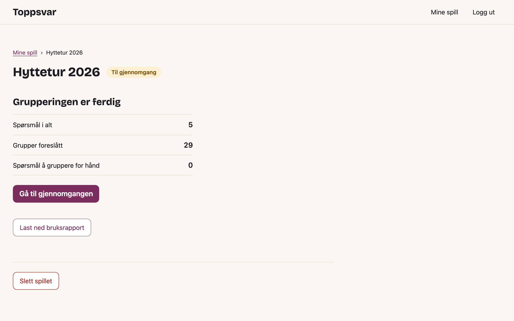
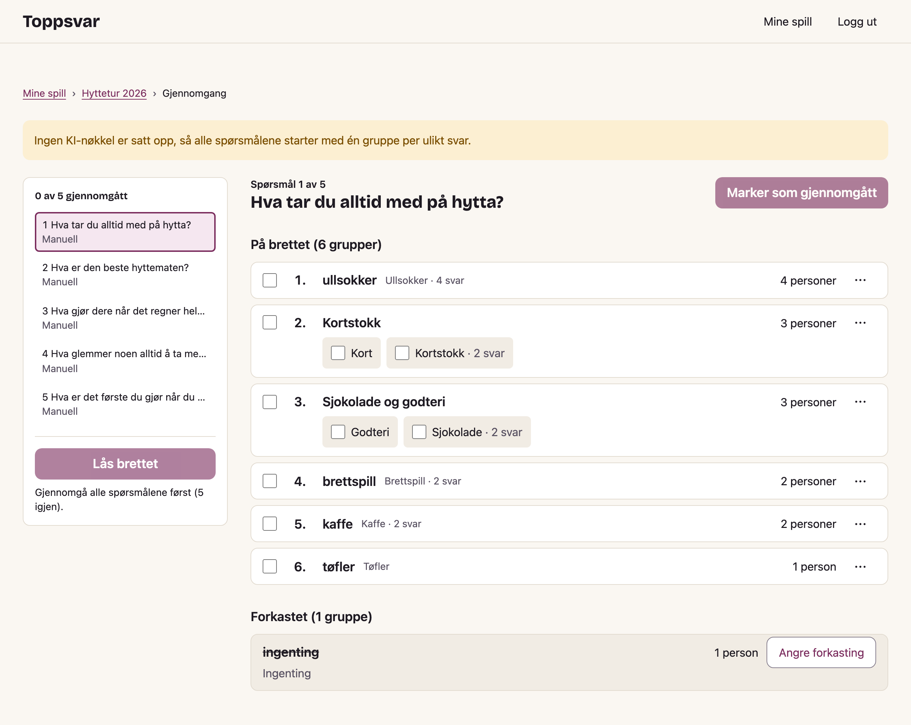
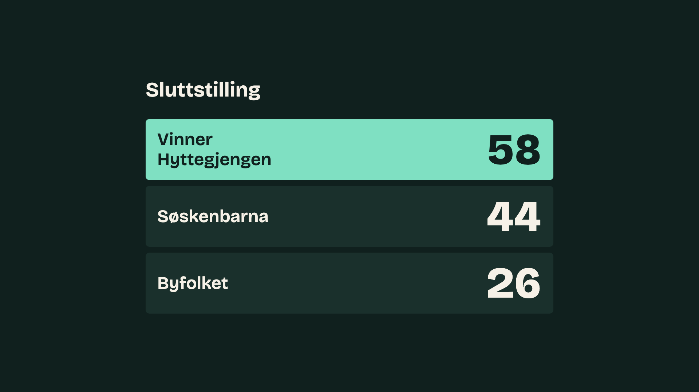
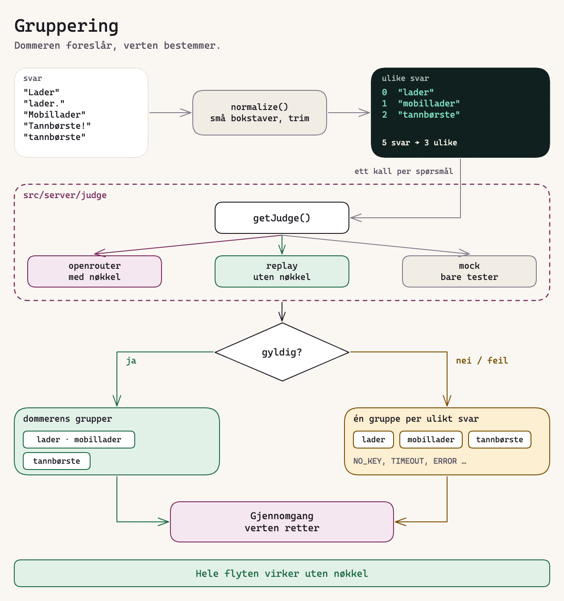
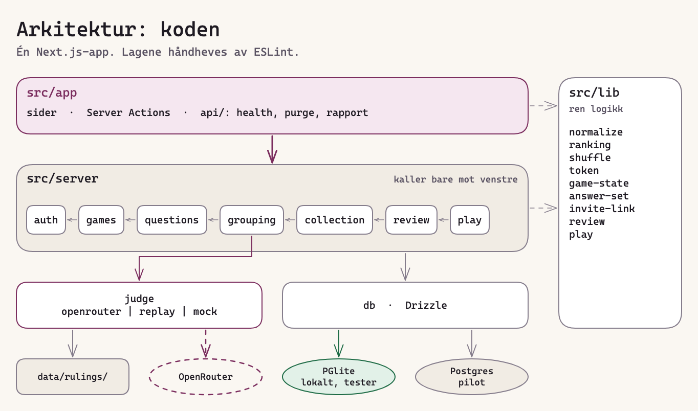

# G101 — Claudeception

Gruppeprosjekt i **IBE160 Programmering med KI** ved Høgskolen i Molde, høsten 2026 (15 studiepoeng).
Her ligger appen, og dokumentasjon av hvordan vi bygde, testet og kvalitetssikret den med KI.

## Produkt

**Toppsvar** er et Family Feud-aktig festspill. Verten lager spørsmål om sin egen gjeng, og
deltakerne svarer anonymt i fritekst. En språkmodell grupperer like svar til rangerte topplister.
Verten retter, og gjengen spiller. Spillet trenger to vinduer, ett på PC-en og ett på TV-en,
eller to enheter: TV-visningen viser bare brettet for rommet, og verten styrer spillet fra
vertsvisningen med fasit på sin egen skjerm. Trinn 2: ferdige spørsmålssett, uten innsamling.

Pilot: <https://toppsvar.vercel.app>. Lokalt trengs verken nøkkel eller konto, se [Utvikling](#utvikling).

## Slik ser det ut

Et oppdiktet spill, «Hyttetur 2026». Gjennomgang, låst brett og lagoppsett er fra piloten, der
dommeren grupperte live. Spillet på TV-en og i vertsvisningen er tatt lokalt i demomodus, med et
ferdig spørsmålssett. Resten er lokalt, uten nøkkel.

**Gjennomgangen.** Verten slår sammen, flytter, gir nytt navn og forkaster grupper. Her er to
valgt. Dommeren hadde alt slått sammen «Ullsokker», «ullsokker» og «ullsokkar».



**Spillet på TV-en.** Spillet spilles alltid med to vinduer eller to enheter. «Start spillet»
åpner lagoppsettet. Når lagene er navngitt, havner verten på spillsiden og åpner «Vertsvisning
med fasit» på PC-en og «Åpne TV-visning» på TV-en. Bruk TV-en som utvidet skjerm, ikke speilet, ellers ser alle fasiten. I
vertsvisningen avslører tall plasser, `M` gir bom, `Z` angrer, `T` gir neste lag, `U` avslører
uten poeng og `N` går til neste spørsmål. `F` i TV-vinduet gir fullskjerm. Lagene ser bare brett
og poeng.


| Deltakeren svarer på mobilen | Verten følger innsamlingen |
|---|---|
|  |  |

<details>
<summary>Flere skjermbilder</summary>

| Skjerm | Bilde |
|---|---|
| Forsiden |  |
| Spørsmålene skrives |  |
| Innsamlingen åpnes |  |
| Engangslenkene |  |
| Svaret er lagret |  |
| Innsamlingen stenges (lokalt, uten nøkkel) |  |
| Dommeren er ferdig (5 spørsmål, 30 grupper, ingen til manuell gruppering) |  |
| Gjennomgang av ett spørsmål |  |
| Forkastede grupper |  |
| Brettet er låst |  |
| Lagene navngis |  |
| Vertsvisningen med fasit |  |
| Sluttstillingen på TV-en |  |

</details>

## Flytene

Laget i [Excalidraw](https://excalidraw.com). `.excalidraw`-fila ved hvert bilde kan åpnes og
redigeres der.

**Oversikt.** Piloten kjører på Vercel og Neon i Frankfurt. Lokalt trengs ingen av delene.
[Kilde](docs-assets/diagrammer/oversikt.excalidraw)


<details>
<summary><b>Vertsflyt</b>: spillets tilstander, fra utkast til sluttstilling</summary>


[Kilde](docs-assets/diagrammer/vertsflyt.excalidraw)

</details>

<details>
<summary><b>Deltakerflyt</b>: personlig lenke, anonyme svar, kan endres til innsamlingen stenges</summary>


[Kilde](docs-assets/diagrammer/deltakerflyt.excalidraw)

</details>

<details>
<summary><b>Anonymitet</b>: stengingen kutter koblingen mellom lenke og svar</summary>

Grensen: selve svarteksten kan avsløre hvem som skrev den.


[Kilde](docs-assets/diagrammer/anonymitet.excalidraw)

</details>

<details>
<summary><b>Gruppering</b>: dommeren foreslår, verten bestemmer</summary>



[Kilde](docs-assets/diagrammer/gruppering.excalidraw)

</details>

<details>
<summary><b>Arkitektur</b>: koden i src/app, src/server og src/lib</summary>



[Kilde](docs-assets/diagrammer/arkitektur.excalidraw)

</details>

## Anonymitet

Ingen kan se hvem som skrev hvilket svar, heller ikke verten. Svarene kan bli sendt til en
ekstern KI-tjeneste for gruppering. Begge deler står øverst i svarskjemaet.

Spill slettes 30 dager etter at de er spilt, ellers 90 dager etter siste endring. Slettingen
kjører når en vert åpner spillsidene (høyst én gang i timen), og i piloten også fra Vercel Cron
den 1. i hver måned. Står piloten ubrukt, kan et spill derfor ligge opptil rundt to måneder.
Pilotdatabasen slettes når emnet er over.

<details>
<summary>Grensene: hvem kan se hva</summary>

1. Verten leser hvert svar slik det er skrevet. Skrivestil anonymiseres ikke.
2. Før stenging kan den som driver databasen, koble en lenkes hash til svarsettet.
3. Etter stenging kan databasens skrivelogg, frigjorte sider og leverandørens historikk holde
   slettede rader en stund.
4. Mellom stenging og låst brett kan antallet svar per spørsmål koble en persons svar på tvers
   av spørsmål. Nøkler og rangering slettes når brettet låses.
5. Med live gruppering sendes svartekstene til modell-leverandøren.
6. Pilotens tilgangslogger lagrer IP-adresser og tidspunkt, aldri lenkens token.
7. Minstekravet på tre svarsett beskytter mot en nysgjerrig vert, ikke mot en som svarer selv
   gjennom lenker hen beholder.
8. Svarene kan bare leses på enheten som sendte dem. Endrer du fra en annen enhet, starter du
   på nytt.
9. Et usendt utkast ligger i nettleseren på deltakerens enhet. Andre som bruker enheten, kan
   lese det.

Bakgrunn: [endringsforslaget fra 23. november](.docs/planning-artifacts/sprint-change-proposal-2026-11-23.md).

</details>

## Ferdige spørsmålssett

Velg et sett under «Spørsmål» når du lager spillet. Da er brettet klart med en gang, uten
innsamling og gjennomgang (FR-33, trinn 2). Spørsmålene og tellingene kommer fra
[ProtoQA](https://github.com/iesl/protoqa-data) av ProtoQA-forfatterne (IESL, UMass Amherst),
lisensiert under [CC BY 4.0](https://creativecommons.org/licenses/by/4.0/), oversatt og
tilpasset av oss. TV-visningen viser kilden.
[Kreditering og endringer](data/protoqa/ATTRIBUTION.md).

<details>
<summary>De fem settene</summary>

- **Hjemme:** Nevn noe folk pleier å gjøre før de går hjemmefra til jobben. Nevn noe folk kan gjøre om garasjen til. Nevn noe i huset som ofte må byttes ut. Nevn noe folk kjøper til et hus, men ikke til en leilighet. Nevn noe folk kjøper som varer lenge.
- **Mat og drikke:** Du kjøper melk, egg, sukker og fløte. Nevn noe du trolig skal lage. Nevn en grønnsak som er omtrent like stor som hodet ditt. Nevn noe du trenger for å lage pizza. Nevn noe en idrettsutøver ikke ville hatt i kjøleskapet sitt. Nevn noe butikker deler ut gratis for å lokke til seg kunder.
- **Jobb og reise:** Nevn en luksus folk må klare seg uten når de er på reise. Nevn en grunn til å endre returbilletten. Nevn en grunn til at en bilist må stoppe i veikanten. Nevn en jobb der man må være våken om natten. Nevn en grunn til å gi servitøren godt med tips.
- **Barn og oppvekst:** Nevn noe som beskytter barn. Nevn noe foreldre sier at barna ikke får lov til. Nevn noe man kan gjøre etter videregående i stedet for å studere videre. Nevn noe folk husker helt til de blir gamle. Nevn et klesplagg du ikke ville lånt bort til noen.
- **Blandet drops:** Nevn et dyr man kan lære å gjøre triks. Nevn noe som er vanskelig å gjette om en person du nettopp har møtt. Nevn en grunn til at noen går med hansker. Nevn noe folk gjør mens tannlegen undersøker dem. Nevn noe du kan finne på å ødelegge med vilje.

</details>

## Medlemmer

- Sondre Alfnes
- Daniel P Sarjomaa

## Leveranser

| Dokument | Fase | Innhold |
|----------|------|---------|
| [`product-brief.md`](product-brief.md) | Fase 1, arbeidskrav | Hva, hvorfor og for hvem. Revidert etter tilbakemelding |
| [`proposal.md`](proposal.md) | Bakgrunn | Stack, datamodell og risiko i fjorårets format |
| [`PRD.md`](PRD.md) | Fase 2 | Krav i trinn 1 og trinn 2 |
| [`DESIGN.md`](.docs/planning-artifacts/ux-designs/ux-Toppsvar-2026-11-21/DESIGN.md) og [`EXPERIENCE.md`](.docs/planning-artifacts/ux-designs/ux-Toppsvar-2026-11-21/EXPERIENCE.md) | Fase 3 | UX, med [mockup](.docs/planning-artifacts/ux-designs/ux-Toppsvar-2026-11-21/mockups/key-screens.html) |
| [`ARCHITECTURE-SPINE.md`](.docs/planning-artifacts/architecture/architecture-Toppsvar-2026-11-21/ARCHITECTURE-SPINE.md) | Fase 3 | Arkitekturbeslutninger AD-1 til AD-24 |
| Refleksjonsrapport | Uke 48–49 | 30 % av karakteren. Leveres 5. desember |

`product-brief.md` og `PRD.md` genereres fra `.docs/planning-artifacts/` med
`./scripts/sync-brief.sh`. Rediger kildene der.

## Prosess

Vi følger **BMAD Method v6.12.0**: brief → PRD → UX og arkitektur → epics og stories →
implementering. Rammeverket ligger i `_bmad/`, skillene i `.claude/skills/`. `ponytail` er alltid
på ved koding: minste endring som løser oppgaven, uten å kutte krav, tester eller sikkerhet.
Promptene arkiveres i [`prompting/`](prompting/README.md).

## Status

Per 23. november. Trinn 1 fryses 1. desember.

- **Trinn 1 er ikke godkjent ennå (SM-1).** Testene og [sporingen](tests/TRACE.md) er grønne. De
  [manuelle sjekkene](tests/manual/checklist.md) og
  [anonymitetsrevisjonen](tests/manual/anonymity-audit.md) gjenstår.
- **Ingenting er kuttet, og ingenting har glidd.** Av glidelista i PRD §6.5 kjører piloten (med
  Vercel Cron én gang i måneden), og kjennelsene er tatt opp live på nytt. Målingen på ekte norske svar (SM-4) er
  ikke kjørt. Det som ikke er ferdig ved frysen, flyttes til trinn 2.
- **Trinn 2 er startet** før trinn 1 er godkjent, etter gruppens valg. [Ferdige
  spørsmålssett](#ferdige-spørsmålssett) (FR-33) er på plass, og det samme er TV-visning og
  vertsvisning med fasit (story 8.5), som siden story 8.6 er den eneste måten å spille på. Egen rekkefølge på brettet (FR-22),
  hjelp til gjetninger (FR-28) og strikes og steals (FR-29) gjenstår.
- **Dommeren mot ProtoQA (SM-2): B-cubed F1 0.6849**, under målet på 0.70. Spørsmål med mange
  ulike svar faller tilbake til én gruppe per svar, og verten slår sammen i gjennomgangen.
  ProtoQA er engelsk. `npm run judge:eval` gjentar tallet uten nett.

<details>
<summary>SM-2: alle versjoner som er prøvd</summary>

Promptversjon 1 og `deepseek/deepseek-v4.1-flash`, 52 spørsmål.

| Resonnering | F1 | Presisjon | Recall | Kall per spørsmål | Falt tilbake |
|---|---|---|---|---|---|
| `none`, lagret | **0.6849** | 0.9809 | 0.5261 | 1.40 | 15, `INVALID_OUTPUT` |
| `none`, første kjøring | 0.6739 | – | – | – | 14, `INVALID_OUTPUT` |
| `medium` | 0.6545 | 0.9911 | 0.4886 | 1.04 | 25, `TIMEOUT` |
| `high` | 0.6304 | 0.9979 | 0.4607 | 1.00 | 33, `TIMEOUT` |

Uten resonnering teller modellen feil fra rundt 40 ulike svar. Med resonnering går store spørsmål
over tidsgrensen på 30 s. Se [historie 7.2](.docs/implementation-artifacts/spec-7-2-judge-evaluation-against-protoqa.md).

</details>

## Utvikling

Krever Node.js 22.13 eller nyere (testet på 22 og 26) og git. Ingen database, nøkkel eller konto.

```bash
git clone https://github.com/IBE160-2026/G101-alfnes-sarjomaa.git
cd G101-alfnes-sarjomaa
npm install
npm run demo                # skriver ut innloggingen
```

Åpne <http://localhost:3000/logg-inn> og logg inn med `demo@toppsvar.test` og `demo-passord`.
Demospillet er oppdiktet og har seks svarsett. Steng innsamlingen, så grupperer dommeren fra
lagrede avgjørelser. Demoverten kan også lage et spill fra et ferdig spørsmålssett.
`.data/demo` lages på nytt ved hver start. `npm run dev` starter tomt i `.data/local`.

**Appen kjører uten noen nøkkel.** Variablene står i [`.env.example`](.env.example). Kopier den
til `.env.local` for å endre noe.

<details>
<summary>Miljøvariablene</summary>

| Variabel | Standard | Hva den gjør |
|---|---|---|
| `DATABASE_URL` | `pglite://.data/local` | `pglite://<mappe>`, `pglite://:memory:` eller `postgres://…` |
| `PORT` | `3000` | Porten appen lytter på. For `npm run dev` og `npm start` settes den i skallet (`PORT=4000 npm run dev`), fordi Next leser porten før `.env.local`. Bare `npm run demo` tar den fra `.env.local`. Står `PORT` likevel i `.env.local`, peker lenkene dit (via `APP_BASE_URL`) mens appen lytter på 3000 |
| `APP_BASE_URL` | `http://localhost:<PORT>` | Adressen i lenkene. `https` slår på sikre informasjonskapsler |
| `OPENROUTER_API_KEY` | tom | Slår på live gruppering gjennom OpenRouter |
| `JUDGE_PROVIDER` | `openrouter` med nøkkel, ellers `replay` | `openrouter`, `replay` eller `mock` |
| `JUDGE_MODEL` | `deepseek/deepseek-v4.1-flash` | Modellen dommeren bruker live |
| `DEMO_MODE` | tom | `1` viser demoinnloggingen og demobåndet |
| `REGISTRATION_CODE` | tom | Krever denne koden ved registrering |
| `CRON_SECRET` | tom | Slår på `GET /api/purge` med denne hemmeligheten |

`npm run demo` setter selv `DATABASE_URL`, `JUDGE_PROVIDER`, `DEMO_MODE` og `APP_BASE_URL`.

</details>

**Uten nøkkel** bruker dommeren lagrede avgjørelser i `data/rulings/`. I egne spill blir hvert
ulike svar en egen gruppe (`NO_KEY`), og verten slår sammen for hånd.

**Med nøkkel** (`OPENROUTER_API_KEY` i `.env` eller `.env.local`) grupperer dommeren live
([målinger](.docs/planning-artifacts/architecture/architecture-Toppsvar-2026-11-21/delivery-notes.md)).
En nøkkel eksportert i skallet vinner over `.env` i nøkkelskriptene (Nodes `--env-file`
overstyrer ikke), så sjekk `echo $OPENROUTER_API_KEY` først.

<details>
<summary>Skript som bruker nøkkelen (aldri i testene eller CI)</summary>

```bash
npm run judge:smoke         # ett live kall: modell, ventetid, tokens og grupper; hopper over uten nøkkel
npm run judge:record -- inn.json .data/rulings/ut.json   # tar opp avgjørelser (AD-14); bare under .data/ eller data/rulings/demo.json og protoqa-dev.json
```

</details>

Testene trenger verken nøkkel eller nettverk:

```bash
npm test                          # Vitest: enhets- og integrasjonstester
npx playwright install chromium   # én gang
npm run test:e2e                  # Playwright, på port 3100 og 3101
npm run judge:eval                # dommeren mot ProtoQA, fra lagrede avgjørelser
```

Stopp `npm run dev` og `npm run demo` før e2e: Next tillater bare én `next dev` per repo.

CI kjører lint, format, typesjekk, migrasjonssjekk, testene, `judge:eval`, e2e og en
demosjekk på Node 22 og 26 uten nøkkel, og integrasjonstestene mot Postgres 17 i en egen jobb
(se [`ci.yml`](.github/workflows/ci.yml)). Feilloggen fra e2e er `dev.log` i en
`toppsvar-e2e-*`-mappe under `$TMPDIR` (macOS) eller `/tmp` (Linux).

<details>
<summary>Database og migrasjoner</summary>

Skjemaet er `src/server/db/schema.ts`. `npm run db:generate` skriver SQL til `drizzle/`, og
`npm run db:migrate` kjører den mot `DATABASE_URL`. PGlite migreres automatisk. Stopp
`npm run dev` før `db:migrate` (én prosess per PGlite-mappe), og start dev på nytt etter
`db:generate`. Slett `.data/` for å nullstille.

</details>

## Dokumentasjon

All prosjektdokumentasjon ligger i [`wiki/`](wiki/index.md): emnekrav, tidsplan, BMAD-faser og
beslutningslogg.

```bash
./scripts/sync-brief.sh     # regenererer product-brief.md og PRD.md
./scripts/scan-cohort.sh    # ser hva andre grupper i emnet har levert
```

<details>
<summary>Mappene</summary>

| Mappe | Innhold |
|---|---|
| `src/app`, `src/components` | Sidene, rutene og komponentene |
| `src/server` | Moduler med databasetilgang, og dommeren |
| `src/lib` | Ren logikk og grenser, delt av resten |
| `src/cli` | Skriptene bak `demo`, `seed:sizing`, `judge:*` og `db:*` |
| `tests/` | Testene, [sporingen](tests/TRACE.md) og [de manuelle sjekkene](tests/manual/checklist.md) |
| `data/` | ProtoQA-data, de ferdige spørsmålssettene og lagrede avgjørelser |
| `drizzle/` | Migrasjonene |
| `docs-assets/` | Skjermbilder og diagrammer |
| [`.docs/`](.docs/) | BMAD-artefaktene: brief, PRD, UX, arkitektur, epics og én spesifikasjon per historie |
| [`wiki/`](wiki/index.md) | Prosjektdokumentasjonen |
| [`prompting/`](prompting/README.md) | Promptarkivet |
| `_bmad/`, `.claude/skills/` | BMAD-rammeverket og skillene |

</details>

<details>
<summary>Innleveringszip</summary>

```bash
./scripts/make-zip.sh       # G101-alfnes-sarjomaa.zip i rotmappa, fra git archive HEAD
```

Bare committede filer kommer med, aldri `.env.local`, `.idea/`, `.data/` eller `node_modules/`.
Skriptet advarer om endringer som ikke er committet. Git-historikken er ikke med i zipen, den
ligger på <https://github.com/IBE160-2026/G101-alfnes-sarjomaa>.

</details>
