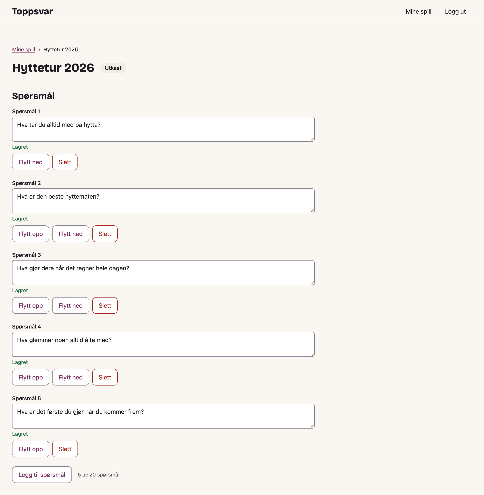
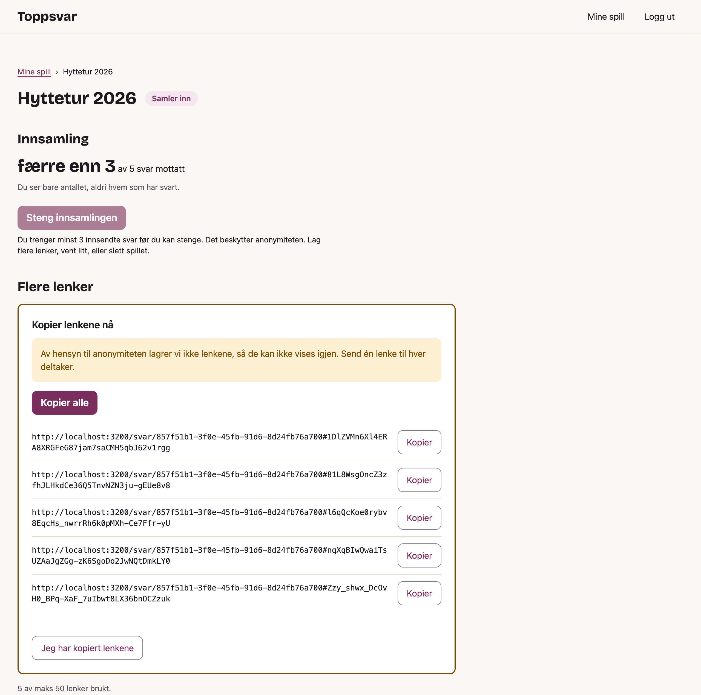
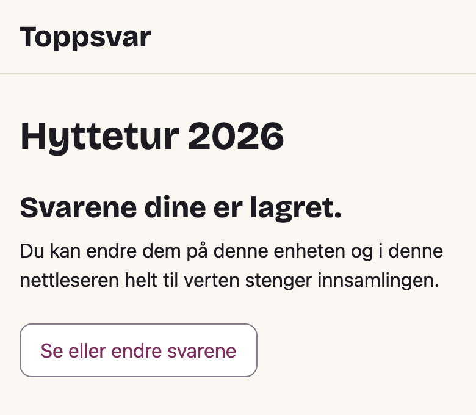
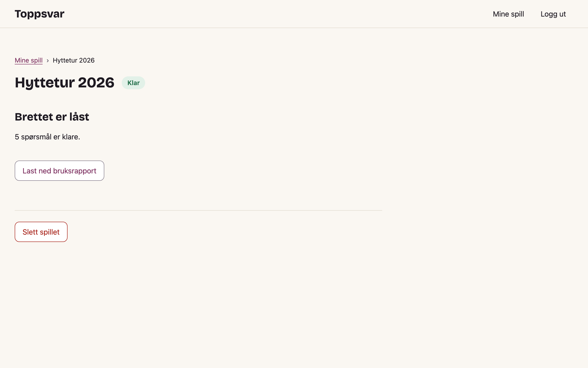
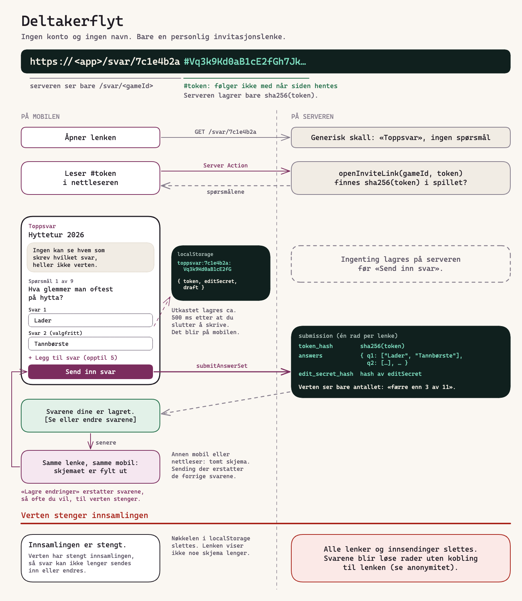
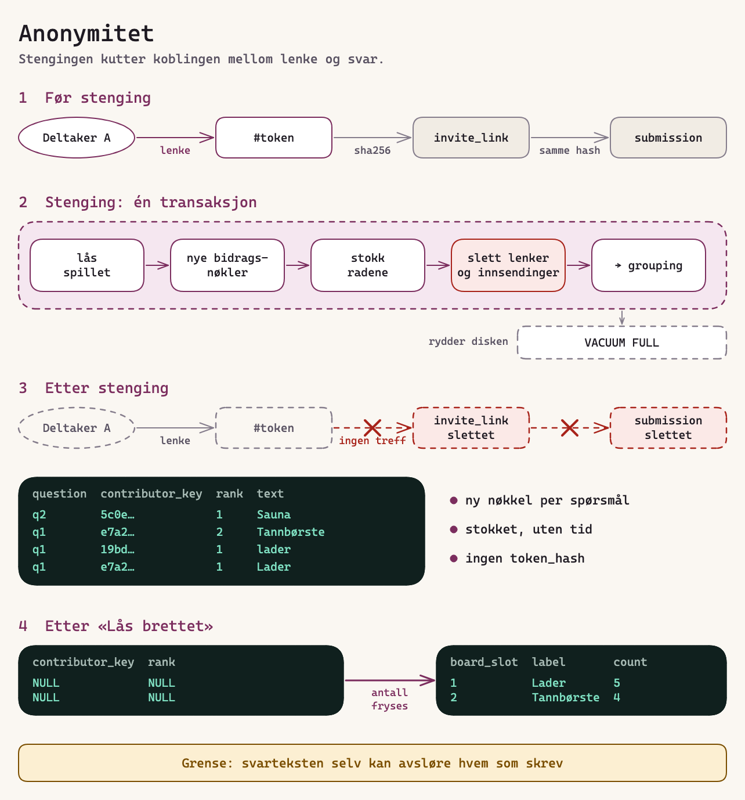

# G101 — Claudeception

Gruppeprosjekt i **IBE160 Programmering med KI** ved Høgskolen i Molde, høsten 2026 (15 studiepoeng).

Repoet inneholder gruppens applikasjon og dokumentasjon av utvikling, testing og kvalitetssikring med KI.

## Produkt

**Toppsvar** — et Family Feud-aktig festspill der verten lager sitt eget spørreskjema om sin
egen gjeng. Deltakerne svarer anonymt i fritekst, en språkmodell grupperer svar som betyr det
samme til rangerte topp-lister, verten retter opp grupperingen, og gjengen spiller live fra én
delt skjerm. I trinn 2 skal et ferdig spørsmålssett la en gjeng spille med én gang, uten å
vente på at et skjema fylles ut.

## Slik ser det ut

Skjermbildene er tatt av den faktiske appen med et oppdiktet spill, «Hyttetur 2026». Gjennomgangen
og låst brett er fra piloten på <https://toppsvar.vercel.app>, der dommeren grupperte svarene live.
Resten er fra en lokal kjøring uten KI-nøkkel. Spillvisningen er også fra piloten.

**Gjennomgangen.** Verten ser de rangerte gruppene per spørsmål, slår sammen, flytter, gir
nytt navn og forkaster før brettet låses. Her er to grupper valgt for sammenslåing. Dommeren
hadde allerede slått sammen skrivemåter som «Ullsokker», «ullsokker» og «ullsokkar».


**Spillet på TV-en.** Verten styrer fra tastaturet: tallene avslører plasser, og `M`, `Z`, `T`, `U` og
`N` gir bom, angre, neste lag, avsløring uten poeng og neste spørsmål. Lagene ser bare brettet og
poengene.


| Deltakeren svarer på mobilen | Verten følger innsamlingen |
|---|---|
|  |  |

<details>
<summary>Flere skjermbilder</summary>

| Skjerm | Bilde |
|---|---|
| Forsiden |  |
| Spørsmålene skrives |  |
| Innsamlingen åpnes |  |
| Engangslenkene |  |
| Svaret er lagret |  |
| Innsamlingen stenges (lokalt, uten nøkkel) |  |
| Dommeren er ferdig (5 spørsmål, 30 grupper, ingen til manuell gruppering) |  |
| Gjennomgang av ett spørsmål |  |
| Forkastede grupper |  |
| Brettet er låst |  |
| Lagene navngis |  |
| Hurtigtastene |  |
| Sluttstillingen |  |

</details>

## Flytene

Diagrammene er laget i [Excalidraw](https://excalidraw.com). `.excalidraw`-fila ved siden av
hvert bilde kan åpnes og redigeres der.

**Verten** lager spillet, samler inn svar, retter grupperingen og spiller. Tilstandene i
midten er de samme som i koden (`src/lib/game-state.ts`).
Kilde: [`vertsflyt.excalidraw`](docs-assets/diagrammer/vertsflyt.excalidraw)


**Deltakeren** får en personlig lenke, svarer anonymt og kan endre svarene fra samme enhet
til innsamlingen stenges. Tokenet ligger etter `#` i lenken og sendes aldri i URL-en til
serveren. Kilde: [`deltakerflyt.excalidraw`](docs-assets/diagrammer/deltakerflyt.excalidraw)



**Anonymiteten** avgjøres når innsamlingen stenges: én transaksjon kutter koblingen mellom
lenke og svar, og ved låsing av brettet slettes også bidragsnøklene.
Kilde: [`anonymitet.excalidraw`](docs-assets/diagrammer/anonymitet.excalidraw)



**Grupperingen** gjøres av en språkmodell når en nøkkel er satt, og ellers av lagrede
kjennelser eller manuelt. Verten har alltid siste ord i gjennomgangen.
Kilde: [`gruppering.excalidraw`](docs-assets/diagrammer/gruppering.excalidraw)


**Arkitekturen** i korte trekk: Next.js App Router, servermoduler i `src/server`, og PGlite
lokalt eller Postgres ved deploy. Kilde: [`arkitektur.excalidraw`](docs-assets/diagrammer/arkitektur.excalidraw)


## Medlemmer

- Sondre Alfnes
- Daniel P Sarjomaa

## Leveranser

| Dokument | Fase | Hva det er |
|----------|------|------------|
| [`product-brief.md`](product-brief.md) | Fase 1, arbeidskrav | Produkthistorien: hva, hvorfor, hvem og hvordan — bevisst uten teknologi. Revidert etter faglærers tilbakemelding |
| [`proposal.md`](proposal.md) | Bakgrunn | Omfang, teknologivalg, datamodell, tidsplan og risiko i fjorårets proposal-format |
| [`PRD.md`](PRD.md) | Fase 2 | Krav: funksjonelle og ikke-funksjonelle, prioritert i trinn 1 og trinn 2 |
| [`DESIGN.md`](.docs/planning-artifacts/ux-designs/ux-Toppsvar-2026-11-21/DESIGN.md) og [`EXPERIENCE.md`](.docs/planning-artifacts/ux-designs/ux-Toppsvar-2026-11-21/EXPERIENCE.md) | Fase 3 | UX: visuell identitet, flyter, tilstander og tilgjengelighet, med [mockup](.docs/planning-artifacts/ux-designs/ux-Toppsvar-2026-11-21/mockups/key-screens.html) av nøkkelskjermene |
| [`ARCHITECTURE-SPINE.md`](.docs/planning-artifacts/architecture/architecture-Toppsvar-2026-11-21/ARCHITECTURE-SPINE.md) | Fase 3 | Arkitektur: stack, datamodell, anonymitet, dommeren, demomodus og tester (AD-1 til AD-24) |
| Refleksjonsrapport | Uke 48–49 | 30 % av karakteren (koden er 70 %). Leveres 5. desember |

`proposal.md` og `product-brief.md` overlapper med vilje ikke: forslaget spesifiserer stack,
datamodell, milepæler og risiko, mens briefen holder seg til opplevelsen og utfallet.
Se [`wiki/kurs/proposal.md`](wiki/kurs/proposal.md).

`product-brief.md` er **generert** fra den kanoniske BMAD-artefakten i
`.docs/planning-artifacts/briefs/brief-Toppsvar-2026-09-14/`, som også inneholder
`addendum.md` og beslutningsloggen `.memlog.md`. Rediger kjøremappa, ikke rotfila, og kjør
`./scripts/sync-brief.sh`.

## Prosess

Prosjektet følger **BMAD Method v6.12.0**: Product Brief → PRD → UX + Arkitektur →
Epics & Stories → Implementering. Rammeverket ligger i `_bmad/` med 39 skills under
`.claude/skills/`. Der ligger også `ponytail`-skillene, som alltid er på ved kodeoppgaver.
De holder KI-generert kode til den minste endringen som løser oppgaven helt, uten å kutte
krav, tester eller sikkerhet.

Prompter arkiveres underveis i [`prompting/`](prompting/README.md) — refleksjonsrapporten
krever eksplisitt at alle stegene dokumenteres, og det lar seg ikke rekonstruere i etterkant.

## Utvikling

Krever Node.js 22.13 eller nyere (testet på 22 og 26) og git. Ingen database å installere,
ingen nøkkel og ingen konto: appen bruker innebygd PGlite i `.data/local` som standard.

```bash
npm install
npm run dev                 # http://localhost:3000, helsesjekk på /api/health
```

Variablene står i [`.env.example`](.env.example). Kopier den til `.env.local` for å endre noe.

Uten nøkkel bruker dommeren lagrede kjennelser fra `data/rulings/` (`JUDGE_PROVIDER=replay`, standard
når nøkkelen mangler). Spørsmål uten lagret kjennelse faller tilbake med grunnkoden
`NO_KEY`: hvert ulike svar blir sin egen gruppe, og verten slår dem sammen for hånd i gjennomgangen. Så lenge `data/rulings/` er tom, gjelder det
alle spørsmål: «Grupper foreslått 0» etter stenging er da forventet, ikke en feil.

Med nøkkel grupperer dommeren pålitelig opptil minst 120 ulike svar per spørsmål (målt 2026-11-22). Et spørsmål med 180 eller flere ulike svar faller tilbake til manuell gruppering. Tallene står i `delivery-notes.md`.

Med `OPENROUTER_API_KEY` i `.env` eller `.env.local` grupperer dommeren svarene live. To skript bruker nøkkelen, og
ingen av dem kjører i testene eller CI:

```bash
npm run judge:smoke         # ett live kall: modell, ventetid, tokenbruk og gruppene; uten nøkkel hopper det over
npm run judge:record -- inn.json .data/rulings/ut.json   # tar opp nye kjennelser (AD-14), bare under .data/ eller data/rulings/demo.json og protoqa-dev.json
```

CI kjører de samme skriptene på Node 22 og 26, uten nøkkel:

```bash
npm run lint                # ESLint, inkludert lagreglene mellom src/app, src/server og src/lib
npm run format:check        # Prettier (npm run format retter)
npm run typecheck           # next typegen + tsc
npx drizzle-kit check       # migrasjonene i drizzle/ henger sammen
npm test                    # Vitest: enhets- og integrasjonstester, uten nettverk
npx playwright install chromium   # én gang
npm run test:e2e            # Playwright mot next build && next start
```

Stopp `npm run dev` før `npm run test:e2e`: e2e starter sin egen `next dev`, og Next tillater bare én per repo. Grunnen står i `dev.log`, i en ny mappe `toppsvar-e2e-*` under systemets temp-mappe (`$TMPDIR` på macOS, `/tmp` på Linux) for hver kjøring.

Databaseskjemaet ligger i `src/server/db/schema.ts`. `npm run db:generate` skriver SQL til
`drizzle/`, og `npm run db:migrate` kjører migrasjonene mot `DATABASE_URL`. PGlite-databaser
migreres automatisk første gang appen bruker databasen. Stopp `npm run dev` før
`npm run db:migrate` (én prosess per PGlite-mappe), start dev på nytt etter `db:generate`, og
slett `.data/` for å nullstille den lokale databasen.

## Dokumentasjon

All prosjektdokumentasjon ligger i [`wiki/`](wiki/index.md) — emnekrav og vurdering,
tidsplan, BMAD-faser, produktidé og beslutningslogg.

Nyttige skript:

```bash
./scripts/sync-brief.sh     # regenererer product-brief.md fra BMAD-kjøremappa
./scripts/scan-cohort.sh    # ser hva andre grupper i emnet har levert, og hvor
```
